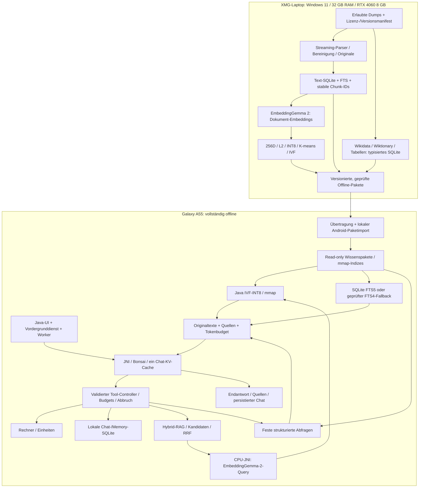

# Bonsai Offline – technische Roadmap

Stand: **22. Oktober 2026**. Zielgerät: Samsung Galaxy A55 5G, Exynos 1480,
Xclipse 530, ARM64, 8 GB RAM, Android 16 / One UI 8.x.

Diese Datei ist eine Analyse und Arbeitsplanung. Sie implementiert keine Features.
Die aktualisierte Grundlage ist `main` bei
`efcd87a0b02fbc0325fbc30a20ce9b1dac291a15`, einschließlich der gemergten
PRs #12 (EmbeddingGemma 2), #13 (Wikipedia), #14 (Wikidata), #15 (native
Chatoberfläche mit Lichtzuständen) und #17 (Icon-Familie).
Releasecode **0.5**, Versionscode **13**, ist über #18 integriert; der lokale
CPU/Vulkan-Build und die tatsächliche signierte APK sind geprüft. Die ältere veröffentlichte
0.4.5-APK und deren Buildnachweis beziehen sich dagegen auf `39b1391…`, also auf einen
älteren Stand **ohne** diesen Encoder. Quellstand, Appversion und ausgelieferte APK
müssen bei jeder Validierung getrennt erfasst werden.

Die Erstanalyse beruhte auf `5584c63…`, danach folgte die reine Dokumentations-
verschiebung `b2ab5a7`. Seitdem ändern #15/#17 Java-Oberfläche, Zeichnung und
Assets; LLM-/Embedding-/RAG-/Wikidata-Kernpfade bleiben gegenüber dieser Basis
unverändert. Der ergänzende [A55-Echtwelttestplan](A55-ECHTWELT-TESTPLAN.md)
verbindet vorhandene Debugausgaben, Geräteversuche und persönliches Nutzerfeedback.

Ergänzung im Featurebranch `feat/editable-system-prompt`, auf Basis des
anschließenden Dokumentationsmerges `b6431a0…`: Der Systemprompt ist nun im
Modellmenü in eigene Vorgaben und zunächst schreibgeschützte Tool-Anweisungen
geteilt. Nur eine bestätigte Warnung entsperrt den Tool-Bereich. Einstellungen
werden lokal und chatübergreifend gespeichert; Vorwärmen, Tool-Schleife und
Cache-Commit nutzen denselben Prompt, Änderungen verwerfen den alten Cache.
Der Chat-Benchmark exportiert dessen SHA256 statt des Prompttexts; Vergleiche
weisen abweichende oder einseitig fehlende Prompt-Hashes zurück. Diese Änderung
ist **nicht in der veröffentlichten v0.5-APK**. Gerätefunktion, Toolwahl und
persönliche UX-Abnahme bleiben offen; siehe die ergänzenden P-Tests im
[A55-Testplan](A55-ECHTWELT-TESTPLAN.md).
In demselben Nachfolgebuild ersetzt die einzelne Wartezeile unter „Bonsai“
den statischen Hinweis durch aktuellen Thinking-Text beziehungsweise
Prompt-Cache-Fortschritt und gemessene Prefill-Tokens/s. Thinking wird separat
gestreamt, auf einen kurzen Ausschnitt begrenzt und weder in Antwort/SQLite noch
Logs übernommen. Fortschritt wird nach nativen Decode-Batches aktualisiert;
keine zusätzliche KV-Allokation und keine Änderung der Decode-Batchgröße.
Live-Anzeige und Modellbefolgung benötigen weiterhin die physische A55-Abnahme.
Hostnachweise des Nachfolgestands: **151 Release-/Robolectric-Tests** bestanden,
Release-Lint ohne Fehler und ARM64-CPU/Vulkan-Build erfolgreich. Einzelheiten,
Grenzen und Renderbilder mit Testdaten:
[Validierung von Prompt und Live-Zeile](docs/validation/SYSTEM-PROMPT-STATUS.md).

## A. Projektziel und Definition of Done

Eine vollständig lokale Android-KI kombiniert Bonsai 2 4B mit lesbaren
Originaltexten, hybrider Suche und kontrollierten lokalen Werkzeugen. Internet ist
nur auf dem Laptop für Beschaffung/Build erlaubt; Inferenz, Query-Embedding,
Retrieval, Gedächtnis und Antwortgenerierung laufen auf dem Telefon. Die App
fordert weiterhin keine `INTERNET`-Berechtigung an.

Die Architektur bleibt Java → JNI → C++/PrismML-llama.cpp, SQLite und Java-IVF.
CPU ist Referenz und Rückfall; Vulkan wird erst nach korrekten Geräteprüfungen
empfohlen. Exynos-NPU-Inferenz ist nicht nachgewiesen und kein zugesagtes Feature.

### Nutzbares MVP

- Eine aus definiertem Commit gebaute APK lässt sich mit bekannter Signieridentität
  installieren und aktualisieren. Chats/Gedächtnis bleiben beim kompatiblen Update erhalten.
- Die offizielle `Ternary-Bonsai-2-4B-PQ2_0.gguf` liefert auf dem A55 verständliche,
  geprüfte Antworten; CPU, Abbruch, Mehrturn-Cache und Hintergrunddienst funktionieren.
  Startkontext: 4096 Tokens; eine gemessene 2048-Token-Alternative ist erlaubt.
- Ein begrenzter, echter deutscher Wikipedia-Bestand kann samt Modell und Index
  ohne `run-as` in eine Release-App importiert werden. Originaltexte, Revision,
  Dumpstand, Chunkzuordnung und Quellen sind nachvollziehbar.
- Derselbe EmbeddingGemma-2-Modellstand und dieselbe Vorverarbeitung erzeugen
  Laptop-Dokument- und Android-Query-Vektoren. Der Versionsvertrag ist überprüft;
  256D/L2/INT8 und IVF haben eine dokumentierte Qualitätsprüfung bestanden.
- Frage → `suche` → FTS + IVF → RRF → Originaltext → Bonsai → gespeicherte Antwort
  mit tatsächlich verwendbaren Quellen funktioniert im Flugmodus auf dem A55.
  Reine FTS bleibt bei fehlendem Encoder mit verständlicher Statusanzeige möglich.
- `calc`, `merken`, `abrufen` und `suche` bestehen eine echte Tool-Routing-Suite;
  ungültige Aufrufe und fehlende lokale Daten verursachen kontrollierte Fehler.
- Geräteprotokolle erfassen Modell-/Paket-Hashes, App-/Runtime-Commit, RAM,
  kalte/warme Latenzen, Thermik und fachliche Antwortprüfung. Kein Absturz in der
  unten definierten MVP-Abnahme. Ein fertiger Build allein erfüllt diese DoD nicht.

### Vollständige Zielversion

Zusätzlich zum MVP: vollständige deutsche Wikipedia ohne Bilder, deutsche
Wikibooks, ausgewählte Stack-Exchange-Communities, ausgewähltes Wikidata,
deutsches Wiktionary sowie Nährwert-/Zahlentabellen. Jedes Paket ist unabhängig
aktivierbar, versioniert, integritätsgeprüft und aktualisierbar. Die App arbeitet
mit Millionen Chunks unter gemessenem Android-Speicherdruck und kann nach einem
Prozessabbruch konsistent wieder geöffnet werden. Tool-Ketten, strukturierte
Fakten, Einheiten und Herkunft sind getestet; Fehler und fehlende Abdeckung
werden nicht als sichere Fakten ausgegeben.

Verbindliche Quellen sind ausschließlich die sechs genannten Gruppen. **OpenStreetMap,
PubMed, Wikivoyage, Project Gutenberg und Wikimedia Commons sind ausgeschlossen.**
Offline-Sprache, semantisches Gedächtnis und symbolische Mathematik sind separat
priorisierte Erweiterungen, keine Voraussetzung für das erste RAG-MVP.

## B. Ist-Zustand und Evidenz

### Statuskonvention

Es gelten genau diese Statuswerte:

- **Implementiert und verifiziert**: die in der Zeile beschriebene Teilfunktion
  wurde mit genanntem Nachweis geprüft; Host-Verifikation bedeutet keine Gerätefreigabe.
- **Implementiert, aber nicht auf Zielhardware verifiziert**: Code ist vorhanden,
  die reale A55-Ausführung beziehungsweise Qualität bleibt offen.
- **In Entwicklung**: vorhandene, noch nicht integrierte PR-Arbeit oder Teilimplementierung.
- **Geplant**: keine entsprechende fertige Implementierung im untersuchten Stand.
- **Blockiert**: eine benannte Voraussetzung verhindert aktuell die Abnahme.

Ein Status gilt für den beschriebenen Umfang, nicht pauschal für ein ganzes Modul.
PR-Aussagen werden als solche gekennzeichnet; Zahlen werden nicht zwischen
unterschiedlichen Commits oder Testsuiten addiert.

| Komponente / Umfang | Status | Begründung und verbleibende Grenze |
| --- | --- | --- |
| Offline-Berechtigungsgrenze | Implementiert und verifiziert | `app/src/main/AndroidManifest.xml`, aktueller Lauf von `scripts/check_project.py`: vier Dienst-/Wake-/Benachrichtigungsrechte, kein INTERNET. |
| Native Java-Oberfläche, Streaming, Chats/Archive | Implementiert, aber nicht auf Zielhardware verifiziert | #15: Chat als Hauptansicht, Modell/Leistung als Pop-ups über Seitenmenü, Modell zusätzlich über Plus in der Chatbar; keine festen unteren Tabs. `AppExperienceTest` prüft Entwürfe, Streaming und Navigation; A55-Tastatur/Touch/TalkBack offen. |
| Appweite Lichtzustände / reduzierte Bewegung | Implementiert, aber nicht auf Zielhardware verifiziert | `PulsingBorder.java`, #15, `docs/UI-REDESIGN.md`: Java-Canvas, gemeinsame 33-ms-Callbacks, Idle/Generating/Done; Pause bei verdeckten Flächen, Activity-Stopp, ausgeschalteten Systemanimationen/Energiesparen im Code getestet. Kein Nachweis von 30 fps, Energiebedarf oder ungestörter echter Inferenz auf dem A55. |
| Icon-Familie / optische Kleinvarianten | Implementiert und verifiziert | #17, `BonsaiIcons.java`, `design/icons/QA.md`, `validation.json`: Host-/native Renderprüfungen für Tint, 16-dp-Varianten und Touchziele. Erneuter Assetcheck: 37 SVG/XML-Paare bestanden. Lesbarkeit/Bedienung auf echtem A55 offen. |
| v0.5-Releaseartefakt / Signatur / Ausrichtung | Implementiert und verifiziert | `release/0.5/build-info.json`, Signaturprotokoll und SHA256: lokal aus `main` gebaut, ARM64/CPU/Vulkan, nicht debuggbar, 138 Release-Tests, null Lintfehler/acht Warnungen; APK-/ELF-16-KiB-Ausrichtung und unveränderte Payload nach Signierung geprüft. Keine A55-Installation oder Inferenz. |
| Hintergrundinferenz, WakeLock, Abbruch | Implementiert, aber nicht auf Zielhardware verifiziert | `InferenceService.java`, `BackgroundInferenceTest.java`; Android-Prozesskill beendet die Berechnung, kein automatischer Neustart. Samsung-Lebenszyklus separat testen. |
| GGUF-Import und dateigebundene Freigabe | Implementiert, aber nicht auf Zielhardware verifiziert | `ModelIntegrity.java`, Importpfad in `BonsaiApp`, `ModelIntegrityTest`/`ModelApprovalTest`. SHA-Abweichung ist kein alleiniger Beweis beschädigter Gewichte; explizite Freigabe bleibt möglich. |
| Bonsai 2 4B / CPU / PQ-/Hadamard-Pfade | Implementiert, aber nicht auf Zielhardware verifiziert | `bonsai_jni.cpp`, `reference_cpu.cpp`, `BackendGuard.java`; echte Host-/QEMU-Modellprüfungen in `VALIDATION-0.4.0.md`. QEMU ist kein Exynos-Gerätetest. |
| Vulkan-Build und Referenzrückfall | Implementiert, aber nicht auf Zielhardware verifiziert | `CMakeLists.txt`, `KernelOptimizer.java`, `BackendGuard.java`, Release-CI. Keine aktuelle Bestätigung korrekter Xclipse-530-Inferenz oder Beschleunigung. |
| Exynos-NPU | Blockiert | `NPU-STATUS.md`: keine nachgewiesene kompatible Exynos-1480-Runtime für Bonsai-PQ/Transformationen. Für CPU-MVP nicht erforderlich. |
| Inkrementeller KV-Cache / Reasoningbereinigung | Implementiert, aber nicht auf Zielhardware verifiziert | `conversation_state.h`, `bonsai_jni.cpp`, `VALIDATION-KV-CACHE.md`, `benchmark/CACHE-AUDIT.md`. Echte Host-JNI-Mehrturntests teils mit SmolLM2, keine Bonsai-A55-Leistungszusage. |
| Benchmarkexport / Optimizer / FA und Q8-KV | Implementiert, aber nicht auf Zielhardware verifiziert | `BenchmarkChat`, `BenchmarkMetrics`, `KernelOptimizer`, `benchmark/README.md`; F16-KV/FA aus bleiben Standard, Q8-KV erfordert FA. Temperatur wird protokolliert, Optimizer hat keine eigene Temperatursperre. |
| `calc`-Parser und Grenzfälle | Implementiert und verifiziert | `Calculator.java`, `CalculatorTest.java`, `ToolLoopTest.java`, vorhandene Host-Testnachweise. Java-Gleitkommarechnung, keine symbolische oder allgemein rationale Exaktheit. |
| `merken` / `abrufen` / DB-Migration | Implementiert und verifiziert | `ChatStore.java` (Schema 3, Upgrade von 1/2), `ChatStoreTest` und `ToolLoopTest`: exakte Schlüssel, persistente Tabelle `memory`, chatübergreifend. Keine semantische Suche. |
| Echte Modellwahl der Tools / GBNF | Implementiert, aber nicht auf Zielhardware verifiziert | `ToolLoop.java`, `ToolGrammar.java`; maximal drei Generierungen, zwei Tools. Native Grammatik-/Hosttests prüfen Format, simulierte Generatoren beweisen keine Bonsai-Routingqualität. |
| `suche`, RRF und persistierte Quellen | Implementiert, aber nicht auf Zielhardware verifiziert | `KnowledgeSearch.java`, `SearchSources.java`, `SearchChatTest`, `KnowledgeSearchTest`; technische Fixtures und UI-Persistenz geprüft, keine belegte quellengetreue Geräteantwort. |
| FTS5 / FTS4-Fallback | Implementiert, aber nicht auf Zielhardware verifiziert | `rag/corpus.py`, `KnowledgeSearch.lexical`: FTS5/BM25 oder FTS4/ROWID. FTS4 ist funktionaler Fallback mit anderer Rangfolge und zusätzlichem Klartextspeicher. |
| IVF-INT8 / mmap / Python-Java-Rangfolge | Implementiert und verifiziert | `rag/ivf.py`, `KnowledgeSearch.IvfIndex`, `IvfSearchTest`, `rag/tests/test_ivf.py`, PR #11. Verifiziert: Host-Format/Ranking; reale A55-Skalierung gesondert offen. |
| Echte EmbeddingGemma-2-Query-Inferenz | Implementiert, aber nicht auf Zielhardware verifiziert | Gemergter PR #12, `EmbeddingGemma2Encoder.java`, `embedding_jni.cpp`, `runtime/`, `rag/VALIDATION-EMBEDDINGGEMMA2.md`: echter Q8_0-Java/JNI-Hosttest, CPU-APK gebaut. |
| Produktiver Modell-/Exportvertrag und Recall | Blockiert | Profilprüfung vorhanden, aber keine numerische HF-F32 ↔ GGUF-Q8-Paritätsmessung, keine realistische gelabelte deutsche Korpusevaluation und kein A55-RAM-Nachweis. Vor vollständiger Vektorisierung schließen. |
| Wiederaufnehmbarer Wikipedia-Import auf Host | Implementiert und verifiziert | Gemergter PR #13; `rag/corpus.py`, `wiki.py`, `chunking.py`, `WIKIPEDIA.md`: stabile int64-IDs, Originale/Revisionen, Markdown, Checkpoints, Fehlerjournal. Aktuelle 39 Python-RAG-Tests bestanden; kein realer Voll-Dump-/Windows-XMG-Nachweis. |
| Vollständige echte Wikipedia / produktiver Index | Geplant | `rag/data/articles.jsonl` enthält 50 selbst verfasste Miniartikel, keine Wikipedia-Extraktion. Auch #13 liefert synthetische Fixtures, keinen Voll-Dump-Nachweis. |
| Wikidata-Pipeline auf Host | Implementiert und verifiziert | Gemergter PR #14, `wikidata/`: aktuelle 14 Pipelinetests und gemeinsamer Fixturevergleich bestanden; typisierte Werte, Auswahl, Resume, Budget. Kein produktiver 7-GB-Bestand. |
| Wikidata-Android-Tool | Implementiert, aber nicht auf Zielhardware verifiziert | `WikidataKnowledge.java`, `WikidataSources.java`, ToolLoop/GBNF, 17 dokumentierte Robolectric-Fachtests. Feste read-only Operationen und begrenzte Graphpfade, keine freie SQL-Schnittstelle; A55-/Bonsai-Toolwahl offen. |
| Wikibooks / Stack Exchange | Geplant | Kein spezialisierter Import, Paket oder Android-Multi-Korpus-Routing im untersuchten Baum/Branch-Snapshot. |
| Wiktionary | Geplant | Kein passender Branch/PR in den abgefragten GitHub-Listen; keine Wörterbuchpipeline im untersuchten `main`. Vor Zuweisung erneut abgleichen. |
| Nährwerte / Konstanten / Einheiten | Geplant | Kein dediziertes Schema, Importprofil, Quellenmanifest oder Tool im untersuchten `main`. |
| Release-Import / Paketupdates / Paketaktivierung | Geplant | RAG-Dateien müssen bislang unter privatem `files/rag` liegen; Anleitung nutzt Debug-`run-as`. Veröffentlichte 0.4.5 ist nicht debuggbar. Modellimport ersetzt keinen Wissenspaketimport. |
| SymPy / STT / TTS / semantisches Gedächtnis | Geplant | Keine entsprechenden Laufzeitmodule im analysierten Appstand. |

### Embedding-Modellidentität: entscheidender aktualisierter Befund

Ursprünglicher Kontext und ältere RAG-Beispiele nennen `google/embeddinggemma-300m`.
**Tatsächlich integriert ist jetzt `google/embeddinggemma-2`**, kein unter demselben
Namen austauschbarer 300M-Encoder. Der Profilname lautet `embeddinggemma2-search-v1`.

| Aspekt | Tatsächlicher Code / Nachweis |
| --- | --- |
| Android-Gewichte | Separates textfähiges GGUF; geprüft wurde `ggml-org/embeddinggemma-2-GGUF`, `embeddinggemma-2-Q8_0.gguf`, Revision `58faf90940886df2d62be555c8765d00dac362c5`, SHA256 `2188ac1deca4b77dffefd603c2776a9d76d9d74ec01841392982ebb840b09135`. Nicht in APK enthalten. |
| Runtime | PrismML `e3de715222b2667c54a267441159a5729f11155e` plus hashgeprüfter Backport aus llama.cpp #30054; `scripts/fetch_runtime.py`, `runtime/embeddinggemma2.patch`. Ein unmodifizierter Submodulcheckout allein reicht nicht. |
| Komponenten | GGUF-Tokenizer/Spezialtokens, bidirektionale Attention, Mean Pooling und trainierte 512→768-Projektion; keine Vision-/Audio-Komponenten. Java reduziert die 768 Werte auf erste 256 und normalisiert erneut. |
| Backend / Kontext | CPU, keine GPU-Layer, mmap-Gewichte; Encoder-Kontext/Batch/Microbatch 1024, F32 K/V und Attention-Zwischenwerte, FA aus. Pro Anfrage laden und anschließend Modell/Kontext freigeben. |
| Laptop | `rag/embeddings.py`: Sentence Transformers, text-only HF-Float32, `trust_remote_code=False`; nicht derselbe Gewichtsquantisierungsweg wie Android-Q8_0. |
| Textformat | Query `task: search result \| query: TEXT`; Dokument `title: TITEL \| text: TEXT`, leerer Titel als `none`; kein zweites automatisches Präfix. BOS/EOS und Tokenlimit müssen mitgeprüft werden. |
| Gespeicherte Vektoren | 256D/L2; BRAGV001 mit individuellem Scale je Vektor, IVF mit globalem `float32(1/127)`. Beides ist unabhängig von Q8_0-Modellgewichten. |
| Schutz | `KnowledgeSearch` prüft Modellname und Exportprofil; fehlende/falsche Gewichte führen zu FTS mit Tool-Warnung, Abbruch wird propagiert. Keine vollständige Bindung von Gewichts-Hash, Tokenizerrevision, DB und Index durch ein Paketmanifest. |
| RAM / Geschwindigkeit | **Nicht auf dem A55 gemessen.** Bonsai bleibt während der Query geladen; nachfolgende Freigabe des Encoders beseitigt den gemeinsamen Spitzenbedarf nicht. Keine belastbare RAM-Zahl aus Modellname/Dateigröße ableiten. |
| Qualität | Ein echtes deutsches Zwei-Dokument-Hostbeispiel und Abbruch/Wiederverwendung sind dokumentiert. Keine HF-F32-Parität, kein repräsentativer Recall, kein kompletter Wikipedia-Export. |

Die Modellfamilie ist damit im Code festgelegt; **produktive Revision,
Gewichtsquantisierung, Tokenizer-/Promptvertrag und Qualitätsschwellen müssen noch
als unveränderliches Exportprofil freigegeben werden**. Ein Modellwechsel verlangt
neue Dokumentvektoren, neue Zentroiden/IVF und erneute Qualitätsabnahme. Alte
300M-/Hash-Vektoren werden nicht als kompatibel umetikettiert.

### GitHub- und Test-Snapshot dieser Analyse

GitHub-Branches, PRs, Releases, offene Issues und aktuelle
Actions waren beim erneuten Abruf zugänglich. #12/#13/#14/#15/#17 sind gemergt;
anschließend wurden auf ausdrücklichen Wunsch #16 (Dokumentation) und #18
(Version/Signierhinweise für v0.5) nach Konflikt-/Prüfkontrolle gemergt.
Keine eigenständigen offenen Issues
im abgefragten Issue-Snapshot. Ein Branch ist kein Beweis, dass gerade ein Agent läuft.

| Arbeit | Referenz / Integrationsstand |
| --- | --- |
| RAG / IVF / Performance | [#9](https://github.com/interfurz/bonsai-offline-a55/pull/9), [#11](https://github.com/interfurz/bonsai-offline-a55/pull/11), [#10](https://github.com/interfurz/bonsai-offline-a55/pull/10): gemergt; `agent-b-rag`, `agent-b-ivf`, `agent-a-perf` existieren historisch weiter. |
| EmbeddingGemma 2 | [#12](https://github.com/interfurz/bonsai-offline-a55/pull/12): gemergt am 22.10.2026; Head `bdddacd…`, Merge `a72f9e5…`. |
| Wikipedia | [#13](https://github.com/interfurz/bonsai-offline-a55/pull/13): gemergt, Merge `bcea0974b41c6d364bbb1a092ffecc7f3ff93ca5`, Head `1e835f33dd60db83d51dbc94741f78a22b061cfe`. Dokumentation: `rag/WIKIPEDIA.md`, `rag/validation/wikipedia/`. |
| Wikidata | [#14](https://github.com/interfurz/bonsai-offline-a55/pull/14): gemergt, Merge `5584c6379195fa2f6f33001234ffa4c2def3eba3`, Head `83d8e2f8ba542be29ceaa40ee2bd7059de5fb4a7`; enthält kombinierten Wikipedia-/Encoder-Stand. Dokumentation: `wikidata/VALIDATION.md`. |
| Native UI / Licht | [#15](https://github.com/interfurz/bonsai-offline-a55/pull/15): gemergt, Merge `aae5381c168ddd8b782fb2cec986299833e930d9`, Head `06ed473…`. Dokumentation: `docs/UI-REDESIGN.md`, `docs/design-qa.md`; 135 dokumentierte Host-/Robolectric-Tests. |
| Icons | [#17](https://github.com/interfurz/bonsai-offline-a55/pull/17): gemergt, Merge `1753b1f…`, Head `e662997…`; baut auf #15 auf. `design/icons/validation.json` dokumentiert 138 Tests, null Fehler/übersprungene Tests, null Lintfehler, acht bestehende Warnungen und einen CPU-Debug-APK-Hash. |
| Wiktionary | Kein entsprechender Branch oder PR im Snapshot. |

Während der Erstanalyse auf `5584c63…` ausgeführt, ohne Anwendungscode zu ändern
(die unveränderten Kernpfade wurden beim Update nicht unnötig erneut getestet):

- `python3 scripts/check_project.py`: bestanden; Manifest/XML, JNI-Namen,
  Runtime-Patchtest sowie kompilierte UTF-8-/Conversation-State-Hostchecks.
- `python3 -m unittest discover -s tests -p 'test_*.py' -v`: **4 bestanden**.
- `python -m unittest discover -s rag/tests -v`: **39 bestanden** auf dem finalen
  integrierten Stand, nach Installation der deklarierten Parser-/NumPy-/
  scikit-learn-/psutil-Abhängigkeiten in separater Umgebung.
  Der erste Lauf ohne Parserabhängigkeit scheiterte; dies war ein Setupfehler.
- `python3 -m unittest discover -s wikidata/tests -v`: **14 bestanden**;
  `python3 -m wikidata.fixtures --check`: gemeinsamer Python-/Android-Fixtureinhalt stimmt.
- Zunächst separat exportierte PR-Stände bestanden ebenfalls (Wikipedia/RAG 39,
  Wikidata 14 Tests). Nach deren extern erfolgtem Merge wurde der eigene Branch
  per Fast-forward auf `5584c63…` aktualisiert und die betroffenen Tests erneut
  ausgeführt. Es wurden durch diese Analyse keine Feature-PRs gemergt.
- `./gradlew --no-daemon --max-workers=2 :app:testDebugUnitTest :app:lintDebug`
  scheiterte beim Gradle-Download mit `java.net.ConnectException: Connection refused`.
  Android-Tests/Lint/APK wurden in der Erstanalyse deshalb **nicht** lokal erneut
  erfolgreich ausgeführt. Beim Update ist unter `/workspace/.cloud-setup/activate.sh`
  eine eingerichtete JDK-/SDK-/NDK-/Gradle-Umgebung verfügbar; der frühere Setupfehler
  ist damit kein grundsätzlich weiterhin fehlendes Buildsystem.
- Keine Modellgewichte geladen, kein physisches A55/ADB, keine RTX-4060-Messung,
  kein vollständiger Dump und keine neuen Geräte-/Geschwindigkeitsbenchmarks.

Vorhandene, nicht mit einem neuen lokalen Lauf zu verwechselnde Evidenz:
`release/0.4.5/build-info.json` meldet für die ältere Release-APK 106 Tests, null Lintfehler,
acht Warnungen und `physical_a55_tested=false`. Die neuere Encoder-Validierung
meldet 112 Android-/Robolectric-Tests, 22 Python-Tests und einen ARM64-CPU-Build.
Die integrierte #14-Validierung meldet 129 Android-Tests einschließlich 17
Wikidata-Tests sowie 39 RAG-Tests nach Einbindung von Wikipedia. Diese Zahlen
beschreiben verschiedene Stände. Neu geprüft: `python3 scripts/check_icons.py`
bestanden; kein neuer A55-Log, kein Nutzerfeedback und kein Geräteergebnis
bereitgestellt. Die Signierdatei für den gewünschten Folgerelease ist kein
Gerätenachweis.

| Neuer CI-Nachweis | Ergebnis / genaue Grenze |
| --- | --- |
| [Android auf `5584c63…`](https://github.com/interfurz/bonsai-offline-a55/actions/runs/39812613552) / [CPU+Vulkan](https://github.com/interfurz/bonsai-offline-a55/actions/runs/39812613332) | Inzwischen beide erfolgreich abgeschlossen; die frühere Angabe „läuft noch“ ist überholt. |
| [CPU+Vulkan auf UI-Merge `aae5381…`](https://github.com/interfurz/bonsai-offline-a55/actions/runs/39816068693) | Erfolgreich. Jobschritte für Release-Unit-Tests, Lint, vollständigen unsignierten APK-Build und native Konfigurations-/APK-Prüfung einzeln geprüft. Enthält #15, noch nicht #17. |
| [CPU auf Icon-Head `e662997…`](https://github.com/interfurz/bonsai-offline-a55/actions/runs/39816736338) | Erfolgreich; Hostchecks, CPU-Referenzkernel, Unit-Tests/Build/Lint-Schritt und Artefaktuploads erfolgreich. Enthält bereits #15. |
| `main`-Merge `1753b1f…` | CPU-Run 39817850473 und CPU/Vulkan-Run 39817850218 sind inzwischen beide erfolgreich abgeschlossen. |

Keiner dieser CI-/Rendernachweise belegt physische A55-Inferenz, echte UI-Bildrate,
Encoder-RAM, Retrievallatenz oder persönliche Nutzerzufriedenheit.

### Release v0.5: neue lokale Nachweise

Die signierte APK wurde lokal aus `main`-Commit `efcd87a…` mit dem
prüfsummengebundenen Vulkan-SDK 1.4.363.0, NDK 28.2.13676358 und dem geprüften
Runtimebackport gebaut. Neue lokale Releaseprüfungen: 138 Tests in CPU- sowie
Vulkan-Buildkonfiguration ohne Fehler/übersprungene Tests, Lint null Fehler/acht
Warnungen, 39 RAG-/Wikipedia-, 14 Wikidata- und vier weitere Python-Tests ohne
Fehler/übersprungene Tests. Damit ist der frühere lokale Setupblocker erledigt.

Die tatsächliche APK hat **68.172.532 Bytes**, enthält die Encoder-/Wikidata-/
Licht-/Iconklassen, aber keine Modellgewichte, Wissens-DBs oder IVF-Dateien.
Manifest, Signatur, alle enthaltenen Bibliotheken und ZIP-/ELF-Ausrichtung sind
geprüft; Signing verändert keine der ZIP-Dateipayloads. Hashes, Herkunft,
CI-Status und Grenzen: [Buildnachweis](release/0.5/build-info.json),
[Signatur](release/0.5/signature-verification.txt),
[Updatevergleich](release/0.5/update-compatibility.json).
Die APK stammt nicht aus einem heruntergeladenen CI-Artefakt: Der Artefaktspeicher
verweigerte den Download. Ein erster CI-Testversuch scheiterte am Robolectric-
Abhängigkeitsdownload; beim unveränderten zweiten Versuch bestand die Teststufe.
Der unabhängige CPU/Vulkan-CI-Lauf 39821276142 ist im zweiten Versuch
vollständig erfolgreich abgeschlossen: Tests, Lint, nativer APK-Build,
Konfigurations-/APK-Prüfung und Artefaktbereitstellung. Der Buildnachweis hält
den genauen Versuch und die lokale Herkunft der signierten APK getrennt fest.
Direkte Release-Asset-Uploads wurden mit HTTP 401 abgewiesen; APK/Hashes werden
über feste Commits des bestehenden `downloads`-Branches verlinkt.

A55-Abnahme und persönliche Nutzererfahrung bleiben vollständig ausstehend.

## C. Zielarchitektur und Datenverträge



Der Paketimport, Multi-Paketbetrieb und zusätzliche strukturierte Tools sind
Zielarchitektur. Aktuell gibt es einen Text-DB-/Indexpfad, einen separaten
Wikidata-DB-Pfad, fünf Tools und einen einzelnen Inferenzworker.

### Verbindliche Schnittstellen

1. **Textpaket:** SQLite enthält lesbare, zlib-komprimierte Originalchunks mit
   Artikel-ID, Titel, vollständigem Überschriftenpfad, Quellen-/Revisionsreferenz
   und Dumpstand. IDs sind positive signed-int64, in Java `long`, niemals über
   JavaScript-`Number` transportiert. #13 ersetzt reihenfolgeabhängige IDs durch
   Inhaltsidentitäten; Text-/Chunkingänderungen können weiterhin neue IDs erzeugen.
2. **Embeddingprofil:** Modell-ID plus immutable HF-/GGUF-Revision und Hash,
   Tokenizer, Query-/Dokumentformat, Pooling/Projektion, Trunkierung,
   Normalisierung, Gewichtsquantisierung und Vektorscale. Das Manifest muss DB
   und Index eindeutig mit demselben Build verbinden. Der heutige Modellname
   mit Profilstring allein erfüllt das noch nicht.
3. **Vektorindex:** `BRAGIVF1` v1; Float32-Zentroiden, uint64-Clustergrenzen,
   int64-Chunk-IDs, 256 signierte INT8-Werte je Zeile, globaler positiver Scale.
   Bestehendes `BRAGV001` bleibt Baseline mit individuellen Scales. Keine
   Vermischung der Quantisierungsformate. Details: [rag/IVF.md](rag/IVF.md).
4. **Retrieval:** derzeit pro Suchkanal 20 Kandidaten, RRF `sum(1/(60+Rang))`,
   Rang ab 1; maximal drei Originaltexte mit je 600 Zeichen pro Aufruf.
   Das sind Zeichen-, keine garantierten Tokenbudgets. Zwei Suchen ergeben
   höchstens sechs Quellen. Später tokenbasiertes Packing und Multi-Paket-ID
   `(dataset_id, chunk_id)` ergänzen; aktuelle Quellendekuplizierung nutzt nur Chunk-ID.
5. **Toolvertrag:** feste Namen und streng validierte Argumente, parametrisierte
   SQL-Templates, read-only Wissens-DBs, Ergebnis-/Zeit-/Kontextlimits und
   Abbruch. Keine vom Modell frei erzeugten SQL-, Python- oder Shell-Befehle.
   Suchtexte sind Daten, keine Systeminstruktionen. `merken` bleibt eine
   ausdrücklich gewünschte Änderung; Wissenspakete bleiben unveränderlich.
6. **Paketlebenszyklus:** neue Generation in separatem Verzeichnis prüfen,
   SQLite-Integrität/FTS/Hashes/ID-Zuordnung bestätigen, dann ein aktives
   Manifest atomar umschalten. Zwei unabhängige Dateiumbenennungen sind kein
   atomarer DB-/Indexwechsel. Alte mmap-Dateien nie überschreiben oder kürzen;
   bis zur geregelten Freigabe ist App-Neustart beim Paketwechsel erforderlich.

### Vorhandene IVF-Beschränkungen

- Java mappt die Vektoren in 256-MiB-Fenstern; Metadaten inklusive IDs müssen
  zusammen kleiner/gleich `Integer.MAX_VALUE` Bytes bleiben. Dateioffsets sind
  `long`, aber der Metadatenbereich hat damit eine eigene Skalierungsgrenze.
- Für K=4096 brauchen Zentroiden rechnerisch 4 MiB. Das ist Formatgröße, kein
  vollständiger RAM-Wert. mmap spart Heapkopien, nicht automatisch RSS/Pagecache.
- Keine Payload-Prüfsumme im Container; Header-/Offsetvalidierung erkennt keine
  beliebigen plausiblen Bitfehler und beweist keine Korpuszugehörigkeit.
- Zentroidenwahl scannt alle K Zentroiden; nprobe=16 ist ein Startwert, kein
  Qualitätsoptimum. Ungleich große echte Cluster können hohe p95-Latenzen erzeugen.
- Produktive Suche verwirft nichtpositive Scores; die Recall-Werkzeuge können
  diese zulassen. Vergleichsberichte müssen denselben Filter ausdrücklich nennen.
- Indexcache identifiziert Dateien über Pfad/Größe/mtime, nicht über Inhaltshash.
  Mappings werden von der JVM freigegeben, ohne garantierten sofortigen Unmap.
- Laptopbau hält Float-Zwischendaten auf Disk, aber Labels/Sortierpositionen
  benötigen O(N)-RAM. Faiss ist für große Trainingsmengen erforderlich;
  scikit-learn ist auf 100.000 Trainingszeilen / 512 Cluster beschränkt.
- 1-/5-Millionen-Hostmessungen nutzen synthetische gleichmäßige Partitionen.
  Der >2-GiB-Test ist eine Sparse-Datei mit wenigen beschriebenen Zeilen.
  Beides beweist weder reale Wikipedia-Qualität noch A55-Performance.

## D. Entwicklungsphasen und Abhängigkeiten

Prioritäten: **P0** beseitigt einen MVP-/Datenkompatibilitätsblocker; **P1** ist
für vollständige Quellenabdeckung/Skalierung erforderlich; **P2** erweitert das
System nach einer stabilen Basis. Keine kalenderbasierten Zusagen ohne gemessenen
Laptopdurchsatz und Zugriff auf das A55. In E bezeichnet „parallel“ technisch
getrennte Arbeit nach Einigung auf die Schnittstellen, keine automatische Zuweisung.

| Meilenstein | Ergebnis / Abschlussgate | Abhängigkeit |
| --- | --- | --- |
| M0 – Geräte- und Modellvalidierung | Bonsai-CPU korrekt, Encodervertrag geprüft, gemeinsamer RAM/Abbruch messbar; Vulkan separat eingeordnet | Aktueller integrierter Quellstand, verifizierte Gewichte, Gerätezugang |
| M1 – Echtes End-to-End-RAG / MVP | Kleines echtes Wikipedia-Paket in Release importiert; echte Geräteantworten und Quellen bestehen Abnahme | CPU-/Encoder-Gates aus M0; Paketvertrag und vorhandene Wikipedia-Pipeline |
| M2 – Vollständige Wikipedia / Millionen Chunks | Voll-Dump reproduzierbar, Resume/Fehlerkontrolle, Qualitäts- und Geräte-Skalierungsbericht | M1, stabiles Exportprofil, Pilotmessung von Disk/RAM/Qualität |
| M3 – Weitere Textquellen | Wikibooks und kuratierte Stack-Exchange-Pakete mit jeweils geprüfter Herkunft | Textpaketvertrag; Parser können parallel zu M2 entstehen, Aktivierung nach Multi-Paket-Gate |
| M4 – Strukturierte Daten | Bestehendes Wikidata real validiert; Wiktionary und Tabellen als sichere lokale Tools | Bestehendes Wikidata unabhängig von Vektoren; gemeinsame Tool-/Importintegration nach M1 |
| M5 – Zuverlässige Agentenfähigkeiten | Nachweisbares Routing, begrenzte mehrstufige Abfragen; optionale Mathematik-/Memory-Erweiterungen | M1 und jeweils benötigte strukturierte Pakete; einfache Routingtests schon M0/M1 |
| M6 – Produktreife / nachgewiesene Optimierung | Updates, Wiederherstellung, Signierung, Langzeittest, gemessene Ressourcenprofile | M2 sowie freigegebene M3-/M4-Pakete; Import/Updategrundlagen beginnen bereits in M1 |

Kritischer Pfad: **M0.1 + M0.3 + M0.4 → M1.1–M1.4 → M2**.
Vulkan darf diesen CPU-Pfad nicht blockieren. M4.1/Wikidata-Auswahl und die
unabhängigen Parserarbeiten können früher laufen. Die gesamte 35-GB-Sammlung
aufzubauen, bevor die Query-/Dokumentkompatibilität stimmt, erzeugt vermeidbare
Neuindizierung und gehört nicht auf den kritischen Pfad.

## E. Konkrete Aufgaben je Meilenstein

Die folgenden Abnahmeschwellen sind **neu vorgeschlagene Entwicklungsziele**, keine
bereits erreichten Messwerte. Werden sie nach einem Pilotlauf verändert, müssen
Datensatz, Begründung und Entscheidung vor dem großen Export dokumentiert werden.

### M0 – Stabilität und Gerätevalidierung

#### M0.1 – Bonsai-CPU auf dem A55 freigeben

- **Priorität / Status / parallel:** P0 / Geplant / ja, getrennt von Laptop-Pipelines;
  Gerätezeit mit M0.2/M0.4 koordinieren.
- **Aufgabe / Module:** aktuelle APK, `ModelIntegrity`, `BackendGuard`, native
  Runtime; PQ2_0 gegen skalaren CPU-Rückfall und vorhandenen Q2_0-Vergleich prüfen.
  UI-Downloadlink zeigt derzeit Q2_0, bevorzugtes Roadmap-Modell bleibt PQ2_0.
- **Voraussetzungen / Abhängigkeiten:** A55-Zugriff, APK-Signaturplan, offizielle
  PQ2_0-Datei (Hash/Größe aus `ModelIntegrity.java`), gepatchte Runtime aus #12;
  keine zusätzliche Wissens-DB erforderlich.
- **Teststrategie:** 20 versionierte deutsche Aufgaben einschließlich einfacher
  Arithmetik, Fakten mit Solltext, Unicode, fünf verbundene Turns, Abbruch und
  Neustart; CPU optimiert und skalar, Kontext 4096, identische Prompts/Seeds.
- **Akzeptanz:** Artefakt mit App-/Runtime-/Patch-/Modellhash, Gerätestand und
  Antworten; alle deterministischen Rechenfälle korrekt, kein Textwirrwarr,
  keine ungültige UTF-8-Ausgabe, alle Abbrüche erlauben die nächste Anfrage.
  Rechenabweichungen vor Backend-Freigabe erklärt/begrenzt; 20 Fälle ohne Prozessabbruch.

#### M0.2 – Vulkan als unabhängige Option bewerten

- **Priorität / Status / parallel:** P1 / Geplant / ja; nach M0.1 auf demselben Gerät.
- **Aufgabe / Module:** `KernelOptimizer`, `BackendGuard`, `benchmark/`, Vulkan-JNI;
  tatsächliches Backend und PQ-/Hadamard-Rechenvergleich protokollieren.
- **Voraussetzungen / Abhängigkeiten:** M0.1, echter CPU/Vulkan-Build mit gepatchter
  Runtime, identische Gewichte, abgekühlter Ausgangszustand je Profil.
- **Teststrategie:** dieselben 20 Korrektheitsfälle; Standardprofil gegen CPU,
  danach Microbatch/FA/Q8-KV einzeln variieren. Je freigegebenem Profil mindestens
  drei unabhängige Sitzungen plus 20 Minuten Dauerlast; TTFT/Decode/RAM/Thermik erfassen.
- **Akzeptanz:** keine ungeklärte Rechenabweichung, keine Geräte-/Treiberabbrüche;
  dokumentierter Median/p95 und Stabilität des Profils. Vulkan nur bei belegtem
  Nutzen empfehlen; ein ungeeigneter GPU-Pfad lässt CPU-MVP freigabefähig.

#### M0.3 – Embeddingprofil und numerische Parität festschreiben

- **Priorität / Status / parallel:** P0 / Blockiert / ja, Laptop-Parität unabhängig
  von Bonsai-Geräteprüfung; produktiver Export wartet auf dieses Gate.
- **Aufgabe / Module:** `rag/embeddings.py`, `EmbeddingGemma2Encoder`,
  `embedding_jni.cpp`, `runtime/`, künftiges Profilmanifest. HF-/GGUF-Revisionen,
  Tokenizer, BOS/EOS, Präfixe, Titelbehandlung, maximale Sequenzlänge und F32/Q8_0 festhalten.
- **Voraussetzungen / Abhängigkeiten:** Zugriff auf genau zugeordnete HF-F32- und
  GGUF-Q8_0-Gewichte; aktueller Host-Smoke ist eine Basis, keine HF-Parität.
- **Teststrategie:** mindestens 100 deutsche Queries und Dokumentabschnitte,
  einschließlich Umlauten, Code/Mathematik, kurzem/langem Text und leeren Titeln;
  dieselben Texte durch HF-F32 und produktive JNI ausführen. 768D und normalisierte
  256D vergleichen, Query-/Dokumentpfade getrennt berichten; Grenzlängen nicht still kürzen.
- **Akzeptanz:** immutable Profil mit Hashes und Rohvektoren; alle Werte endlich,
  256D-Norm innerhalb `1e-4` von 1. Vorschlag: 256D-Cosinus HF↔Q8_0 mindestens
  0,99 pro Fall und höchstens 2 Prozentpunkte Recall@10-Verlust gegenüber F32
  auf dem M1-Korpus. Bei Abweichung Ursache lösen oder anderes gemeinsames
  freigegebenes Exportverfahren wählen; kein Vollindex mit ungeklärtem Profil.

#### M0.4 – Gemeinsamen Speicherbedarf und Encoder-Lebenszyklus messen

- **Priorität / Status / parallel:** P0 / Geplant / nein während anderer Gerätebenchmarks.
- **Aufgabe / Module:** Encoder-JNI, `BonsaiApp`-Worker, Inferenzdienst und
  Diagnoseexport; Modell, Chat-KV, Encoder-F32-Kontext und mmap-Seiten gemeinsam erfassen.
- **Voraussetzungen / Abhängigkeiten:** M0.1 und funktionsfähige #12-Gewichte;
  für abschließende Qualitätsabnahme M0.3. 1024er Encoder-Batch nicht mit tatsächlicher Querylänge verwechseln.
- **Teststrategie:** leere App, geladenes Bonsai, Query-Load/Decode/Free,
  zehn Wiederholungen, Appwechsel/Display aus, Android-Speicherdruck; RSS/PSS,
  native/Java-Anteile, `MemAvailable`, LMKD-/Thermalereignisse und Ladezeit aufnehmen.
- **Akzeptanz:** Peak und Rückgang nach Freigabe dokumentiert, keine fortlaufende
  Speicherzunahme oder LMKD-Abbrüche in zehn Zyklen; CPU-4096-Konfiguration besteht
  oder gemessener kleinerer Kontext/anderer Encoder-Ladeplan wird vor M1 festgelegt.
  Keine Behauptung, die Android-Leerlaufanzeige bedeute exakt 4 GB Appbudget.

### M1 – Funktionierendes End-to-End-RAG und MVP

#### M1.1 – Echten Wikipedia-Pilotbestand erzeugen und begutachten

- **Priorität / Status / parallel:** P0 / Geplant / ja, nutzt bestehende #13-Pipeline.
- **Aufgabe / Module:** `rag/corpus.py`, `wiki.py`, `chunking.py`, `WIKIPEDIA.md`;
  einen dokumentierten Ausschnitt von zunächst 1.000 echten Artikeln aus einem
  verifizierten dewiki-Snapshot importieren, zusätzlich gezielte Fach-/Weiterleitungsfälle.
- **Voraussetzungen / Abhängigkeiten:** erlaubter Dump, geprüfte Quellprüfsumme,
  Revisions-/Lizenzmetadaten; Schema und stabile IDs aus #13, kein neuer Importer.
- **Teststrategie:** 50 manuell ausgewählte Artikel auf Einleitung, vollständige
  Überschriftenpfade, Tabellen-/Formel-/Vorlagenverluste, Bibliografiebehandlung
  und Source↔Chunk vergleichen; Abbruch/Resume gegen frischen Lauf prüfen.
- **Akzeptanz:** vollständiger Importbericht und erklärtes Fehlerjournal,
  `PRAGMA integrity_check=ok`, keine fehlenden FTS-Chunkzuordnungen; Wiederanlauf
  logisch identisch, Originale erhalten. Verluste explizit beschrieben;
  Dumpdatum/-hash, Revision und Attribution im Paket nachweisbar.

#### M1.2 – Echtes Hybridpaket und getrennte Qualitätsbaselines bauen

- **Priorität / Status / parallel:** P0 / Blockiert / ja zu Import-UI; wartet auf M0.3.
- **Aufgabe / Module:** `rag embed`, `rag.ivf`, `compare`, `evaluate_ivf`,
  Queryexport; Pilotkorpus mit freigegebenem Profil verarbeiten und DB/Index binden.
- **Voraussetzungen / Abhängigkeiten:** M0.3, M1.1; mindestens 100 unabhängig
  formulierte, gelabelte Fragen einschließlich Paraphrasen, Namen, Zahlen und Nichttreffern.
- **Teststrategie:** native F32-Dimensionen → 256D-F32 → INT8-Vollscan → IVF für
  mehrere nprobe-Werte → FTS → RRF getrennt auswerten. Artikel-Recall, Chunk-/
  Evidenzrelevanz, MRR/nDCG und Nachbar-Recall nicht gleichsetzen; Daten zum Tuning
  von zurückgehaltenen Abnahmefragen trennen.
- **Akzeptanz:** reproduzierbare Ranglisten und Rohwerte; Vorschlag auf mindestens
  100 Abnahmefragen: Gold-Artikel-Recall@10 ≥0,85, Verlust 256D/INT8 gegenüber
  jeweiliger Vorgängerstufe ≤2 Prozentpunkte, IVF-Nachbar-Recall@10 ≥0,95 bei
  gewähltem nprobe; RRF-Top-3 mit brauchbarer Evidenz für ≥80 % beantwortbare Fragen.
  Keinen Produktionsanspruch aus den 50 Hash-Fixtures ableiten.

#### M1.3 – Sicheren lokalen Paketimport in Release ermöglichen

- **Priorität / Status / parallel:** P0 / Geplant / ja, eigener PR mit Importmodul;
  `MainActivity`-Anbindung mit Integrationsverantwortlichem koordinieren.
- **Aufgabe / Module:** neuer Paketleser/-validator, Android Storage Access
  Framework, Einstellungen; SQLite/IVF/Encoder-Gewichte und Manifest per lokaler
  Dateiauswahl übernehmen. Bei getrennten Gewichten deren Hash im Profil referenzieren.
- **Voraussetzungen / Abhängigkeiten:** Vertrag C, vorhandener privater
  Modellimport als Muster, Pilotpaket M1.2 für abschließenden Test; keine Speicher-/Internetberechtigung nötig.
- **Teststrategie:** beschädigter Hash, falsches Modell, abgeschnittener Index,
  unvollständige DB, Dateipfad-Traversal bei Archiven, Platzmangel, Abbruch/Kill;
  gültiges Paket in **nicht debuggbarer** APK installieren und nutzen.
- **Akzeptanz:** jede ungültige Generation abgewiesen, altes aktives Paket bleibt
  nutzbar; gemeinsamer DB-/Indexwechsel atomar über Generation/Manifest, freier
  Speicher vor Kopie geprüft. Fortschritt, Abbruch, Quelle und Paketversion sichtbar;
  Einrichtung vollständig ohne ADB/`run-as` und ohne Netz möglich.

#### M1.4 – RAG-Antworten, Quellen und Kontext auf dem A55 abnehmen

- **Priorität / Status / parallel:** P0 / Geplant / nein, abschließender integrierter MVP-Test.
- **Aufgabe / Module:** `ToolLoop`, `KnowledgeSearch`, `SearchSources`,
  Kontextverwaltung, Warnungsanzeige; vorgeschlagenes Tokenpacking statt alleiniger Zeichenlimits.
- **Voraussetzungen / Abhängigkeiten:** M0.1/M0.4 und M1.1–M1.3; tatsächliche
  `suche`-Wahl durch Bonsai, kein eingesetzter Testgenerator.
- **Teststrategie:** 30 echte deutsche Nutzerfragen (20 beantwortbar, 5 außerhalb
  des Bestands, 5 mehrdeutig/mit fehlerhafter Voraussetzung), Flugmodus; zusätzlich
  langer Chat nahe 4096 Tokens, zwei Suchen, fehlender Encoder und fehlerhafte DB.
  Quelleninhalt gegen Antwortaussage manuell prüfen.
- **Akzeptanz:** bei ≥18/20 beantwortbaren Fragen fachlich gestützte Antwort mit
  passender Quelle; bei allen zehn übrigen Fragen fehlende Abdeckung/Unsicherheit
  korrekt behandelt. Keine erfundenen Quellen-IDs, kein Überlauf, keine Tool-Tags
  in UI/DB, Quellen nach Neustart erhalten; FTS-Fallback als solcher sichtbar.
  Erreichen von Retrieval <1 s separat messen; Nichterreichen offen berichten.

### M2 – Skalierung auf vollständige deutsche Wikipedia

#### M2.1 – Laptop- und Speicherpilot vor dem Voll-Lauf

- **Priorität / Status / parallel:** P1 / Geplant / ja zu M4-Parser-/Datenarbeit.
- **Aufgabe / Module:** bestehende Wikipedia-Pipeline, `benchmark_ingest`,
  Embedding-/IVF-Bau; Pilotstufen 10.000 und 100.000 echte Artikel auf XMG ausführen.
- **Voraussetzungen / Abhängigkeiten:** M1-Qualitätsgate, stabiler Profilhash,
  Windows-/WSL-Buildplan, SSD-Freiraum und passende CUDA/Faiss-Installation.
- **Teststrategie:** Import, Resume, Embedding und IVF jeweils wall time,
  Prozess-/Worker-RSS, VRAM, DB/FTS4/Originale, Temp-/WAL-/Referenzdateien messen;
  `--batch` an 8-GB-VRAM anpassen, F32-Aktivierungen beachten.
- **Akzeptanz:** reproduzierbarer Größen-/Laufzeitbericht mit klarer Extrapolations-
  bandbreite und freien Reserven; kein OOM/VRAM-Abbruch. Full-Run-Start nur, wenn
  Temp-, Referenz-, Sortier- und Doppelpufferbedarf in 32 GB RAM/SSD passen.

#### M2.2 – Voll-Dump reproduzierbar importieren, einbetten und publizieren

- **Priorität / Status / parallel:** P1 / Geplant / nein innerhalb derselben DB-Generation.
- **Aufgabe / Module:** `rag/`, Profil-/Paketmanifest; vollständigen Snapshot
  einschließlich Originalen und Versionen erzeugen, Fehlerauflistung und Attribution abschließen.
- **Voraussetzungen / Abhängigkeiten:** M2.1, M1.2/M1.3, freigegebenes Chunking;
  Import vor Embedding abschließen. #13 lehnt Resume nach Vektorisierung bewusst ab.
- **Teststrategie:** geplanter Importabbruch/Resume, FTS-/Chunkzählungen,
  SQLite-Integrität und Exporthashes; Modell-/Chunkprofil unverändert halten.
  Embedding hat derzeit kein allgemeines Resume: vor Voll-Lauf getrennten,
  geprüften Restart-/Shardplan bauen oder ausreichend belegte Wiederholbarkeit vorsehen.
- **Akzeptanz:** `ingest_status=complete`, keine ungeklärten verworfenen Artikel,
  Vektorzahl/ID-Menge deckungsgleich mit Chunks, Datei-/Profilhashes vollständig,
  Originalleseprobe aus allen Importbereichen. Endgrößen tatsächlich messen und
  mit 18-GB-Wikipedia-Ziel vergleichen; keine stille Quellenreduktion bei Überschreitung.

#### M2.3 – Reale Millionen-Indizes auf dem A55 messen

- **Priorität / Status / parallel:** P1 / Geplant / nein während anderer Gerätebenchmarks.
- **Aufgabe / Module:** `KnowledgeSearch.IvfIndex`, Gerätebenchmark, RAG-Export;
  echte 1-Mio.- und, sofern vorhanden, 5-Mio.-Chunkstufen plus Vollindex prüfen.
- **Voraussetzungen / Abhängigkeiten:** M2.2 oder repräsentative Zwischenstufe,
  identische exportierte Queries, bestandene Parität, Importworkflow.
- **Teststrategie:** K/nprobe variieren; je ≥100 Queries, drei unabhängige Sessions,
  erste/warme Zugriffe getrennt, Öffnen/Zentroiden/Scan/FTS/RRF/Query-Modell einzeln,
  Pagefaults, PSS/RSS, Clustergrößen-p95/max und Recall auf echtem Goldset erfassen.
- **Akzeptanz:** Zahlen mit Rohwerten, Index-/Gerätehash und Cacheprotokoll;
  M1-Qualitätsgate bleibt erfüllt, keine Speicher-/Metadatenlimitverletzung.
  Ziel: warme Retrieval-p95 <1 s inklusive Query-Embedding, FTS und RRF,
  ohne LLM-Generierung; kalte Encoderladezeit gesondert. Verfehlung wird zum
  begründeten Optimierungsauftrag, nicht als Erfolg umgedeutet.

### M3 – Wikibooks und ausgewählte Stack-Exchange-Communities

#### M3.1 – Multi-Paketvertrag und Quellenidentität ergänzen

- **Priorität / Status / parallel:** P1 / Geplant / ja, Schnittstelle vor Parserintegration festschreiben.
- **Aufgabe / Module:** Paketverwaltung, `KnowledgeSearch`, `SearchSources`;
  getrennte read-only DB-/IVF-Pakete, Aktivierung/Deaktivierung und Quellen-ID aus
  Paket-ID + Chunk-ID; globales Kandidaten-/Tokenbudget.
- **Voraussetzungen / Abhängigkeiten:** M1.3/M1.4; kein vollständiger Wikipedia-Export nötig.
- **Teststrategie:** gleiche Chunk-ID in zwei Paketen, deaktiviertes/beschädigtes
  Paket, unterschiedliche Profilversionen, zwei Suchen und Paketwechsel.
- **Akzeptanz:** keine Quellenkollision, kein Vermischen inkompatibler Vektoren,
  aktivierte Pakete und ihre Versionen in Diagnose sichtbar; Deaktivierung
  beendet neue Zugriffe und respektiert lebende mmap-Snapshots.

#### M3.2 – Deutsche Wikibooks als Textpaket

- **Priorität / Status / parallel:** P1 / Geplant / ja, eigener `pipelines/wikibooks/`-Bereich.
- **Aufgabe / Module:** spezialisierter Adapter auf Textpaketvertrag;
  Buch-/Kapitel-/Abschnittsstruktur, Originale, Links, Revision/Attribution.
- **Voraussetzungen / Abhängigkeiten:** M1-Profil und Chunkvertrag, M3.1 für
  Android-Aktivierung; Wikipedia-Reader nicht ohne Buchstrukturprüfung übernehmen.
- **Teststrategie:** mindestens zehn Bücher mit Navigation, Unterseiten,
  Code/Formeln und Kapitelketten; 50 gelabelte Lernfragen plus FTS-/Quellenprüfungen.
- **Akzeptanz:** stabile Buch-/Kapitelbezüge, keine Navigationsseiten als
  unmarkierte Fachinhalte, Wiederanlauf/Hashes nachgewiesen; M1-Qualitätsmaßstäbe
  auf dieser Quelle gesondert berichtet, Lizenzen und tatsächliche Größe erfasst.

#### M3.3 – Kuratierten Stack-Exchange-Bestand aufbauen

- **Priorität / Status / parallel:** P1 / Geplant / ja, eigener `pipelines/stackexchange/`-Bereich.
- **Aufgabe / Module:** Importadapter für ausgewählte Inhalte aus Stack Overflow,
  Mathematics, Physics, Electronics, Super User; Auswahlprofil/Sprachen/Tags/Datum
  dokumentieren. Frage, Antworten, akzeptierte Antwort, Bewertung und Code erhalten.
- **Voraussetzungen / Abhängigkeiten:** erlaubte offizielle Dumps, überprüfte
  Lizenz-/Attributionsregeln je Beitragsversion, M3.1/M1-Profil.
- **Teststrategie:** ≥100 Frage-Antwort-Gruppen mit mehreren Antworten,
  nicht akzeptierter höchster Bewertung, Formeln, Code, gelöschten/fehlenden Eltern;
  Quellen-/Autor-/Lizenzzuordnung und semantische Fragen prüfen.
- **Akzeptanz:** keine verwaisten Antworten oder still verlorenen Codeblöcke;
  ursprüngliche Antwort-URLs und Metadaten erhalten, nachvollziehbare Auswahl
  innerhalb gemessenem 6-GB-Ziel oder offen ausgewiesene Budgetabweichung.

### M4 – Strukturierte Wissensdatenbanken

#### M4.1 – Vorhandenes Wikidata mit echtem Teilbestand validieren

- **Priorität / Status / parallel:** P1 / Geplant / ja, Vektormodell-unabhängig;
  vorhandenes #14 weiterführen, keinen zweiten Graphimporter schreiben.
- **Aufgabe / Module:** `wikidata/pipeline.py`, Auswahlprofil, `schema.sql`,
  `WikidataKnowledge`, `WikidataSources`; echte thematische Auswahl, vollständige
  Label-/Property-Nachladung, Abdeckung und 7-GB-Dateibudget prüfen.
- **Voraussetzungen / Abhängigkeiten:** Snapshot/Prüfsumme und begründetes
  Q-/P-Filterprofil; Paketimport M1.3 für normale Release-Nutzung.
- **Teststrategie:** 100 Sollabfragen über `resolve`, `facts`, `path`, `greater`,
  `largest`, `count`; Aliasmehrdeutigkeit, Ranks, Datum/Kalender, Qualifikatoren,
  Referenzen, exakte Dezimalwerte/Einheiten und unvollständige Graphen;
  Abbruch/2-s-Watchdog und reale Klassenfrontiers auf dem A55.
- **Akzeptanz:** alle Sollwerte im dokumentierten lokalen Teilbestand korrekt,
  Auslassungen sichtbar. Insbesondere `count` ist keine weltweite Gesamtzahl.
  Der endliche Float64-Zahlenindex plus BigDecimal-Vergleich wird mit Grenzfällen
  belegt; nichtindexierbare Werte nicht als vollständig durchsuchbar versprechen.
  DB ≤7.000.000.000 Bytes gemäß aktuellem Importlimit oder Auswahlprofil revidiert.

#### M4.2 – Deutsches Wiktionary strukturiert importieren

- **Priorität / Status / parallel:** P1 / Geplant / ja, eigener `wiktionary/`-Bereich;
  neuer Auftrag nach erneutem Branch-/PR-Abgleich möglich.
- **Aufgabe / Module:** Schema/Parser für Lemma, Sprache, Wortart, mehrere
  Bedeutungen, Definitionen, Flexion, Grammatik, Übersetzungen, Synonyme/Antonyme,
  Etymologie; Unicode-/Wortformsuche, kein Vektorindex.
- **Voraussetzungen / Abhängigkeiten:** erlaubter de-Wiktionary-Dump, Lizenz-/
  Revisionsvertrag; Android-Toolregistrierung mit M4.3/M5 koordinieren.
- **Teststrategie:** ≥100 unterschiedliche Einträge, Homonyme, Umlaute/ß,
  Mehrwortausdrücke, mehrere Sprachen/Bedeutungen und fehlende Felder;
  Originaltext↔strukturierte Felder manuell kontrollieren.
- **Akzeptanz:** jede Bedeutung hat stabile ID/Quelle, keine Vermischung von
  Sprachen/Sinnen; exakte Lemma-/Aliasabfragen parametrisiert, fehlende Einträge
  eindeutig. Wiederanlauf/Integrität/Paketimport und A55-Toolpfad geprüft.

#### M4.3 – Nährwert-, Konstanten- und Einheitentabellen anbinden

- **Priorität / Status / parallel:** P1 / Geplant / ja, eigener `tables/`-Bereich;
  gemeinsame Tooldateien über einen Integrations-PR.
- **Aufgabe / Module:** versioniertes SQLite-Schema, Quellen-/Lizenzmanifest,
  feste Abfragen für Lebensmittel, Makro-/Mikronährstoffe, physikalische und
  mathematische Konstanten, Einheiten/Umrechnungsfaktoren.
- **Voraussetzungen / Abhängigkeiten:** konkrete vertrauenswürdige Tabellenquelle
  innerhalb dieser festgelegten Datengruppe auswählen und Nutzungslizenz prüfen;
  Definition von Portion/100 g, roh/gegart, Einheit, Unsicherheit und Datenstand.
- **Teststrategie:** ≥50 Referenzfälle; Dezimal-/Bruchwerte, Präzision, fehlend vs.
  null, inkompatible Dimensionen, affine Temperaturumrechnung und Mehrdeutigkeit.
- **Akzeptanz:** Werte samt Bezugseinheit/Herkunft reproduzierbar, kein stilles
  Ersetzen fehlender Daten durch 0; Einheiten mathematisch konsistent und feste
  parametrisierte Abfragen ohne freie SQL-Eingabe. Keine unbegründete Exaktheit
  empirisch gemessener Nährwerte oder physikalischer Messkonstanten behaupten.

### M5 – Zuverlässige Agentenfähigkeiten

#### M5.1 – Routing- und Kettenqualität messen

- **Priorität / Status / parallel:** P1 / Geplant / ja, Testsammlung separat;
  Änderungen an `ToolLoop`/`ToolGrammar` zentral integrieren.
- **Aufgabe / Module:** fünf bestehende Tools einschließlich `wikidata` und
  spätere registrierte Fachtools; eine geteilte Goldsuite für Toolwahl,
  Argumente, Ergebnisinterpretation, Herkunft und Abbruch.
- **Voraussetzungen / Abhängigkeiten:** M1, benötigte M4-Pakete; das aktuelle
  Zwei-Aufruf-Limit bleibt Ausgangspunkt, keine unbegrenzte Agentenschleife.
- **Teststrategie:** ≥100 Fälle: direkte Antworten, Rechner, Gedächtnis,
  Hybrid-/Faktensuche, Kombinationen, Fehlerkorrektur, irreführende Quellentexte;
  GBNF an/aus mit realem Bonsai auf Host und A55 vergleichen.
- **Akzeptanz:** vorgeschlagen ≥95 % gültige Toolformate, ≥90 % richtige Toolwahl,
  null ungültige Schreiboperationen, alle Läufe begrenzt/beendbar. Ketten mit
  mehr als zwei Tools erst nach expliziten Zeit-/Token-/Aufrufbudgets freigeben.

#### M5.2 – Lokale Mathematik-Engine begründet auswählen

- **Priorität / Status / parallel:** P2 / Geplant / ja, isolierter Prototyp außerhalb produktiver Tooldateien.
- **Aufgabe / Module:** Evaluationsdokument und später separater Mathematikadapter;
  SymPy mit Android-Python-Einbettung gegen geeignete lokale Alternativen vergleichen.
- **Voraussetzungen / Abhängigkeiten:** vorhandenen Java-Rechner als einfache
  Baseline behalten; APK-/RAM-/Startzeit-/Lizenz-/Offlinekosten messen.
- **Teststrategie:** ≥50 Aufgaben zu rationalen Zahlen, Algebra, Gleichungen,
  Ableitung und sinnvoll begrenzten Integralen; Timeout, große Ausdrücke,
  Annahmen und Einheiten explizit prüfen.
- **Akzeptanz:** dokumentierte Auswahlentscheidung mit Gerätemessung und
  Ergebniskorrektheit; keine freie Python-`eval`-Schnittstelle. SymPy erst nach
  tatsächlich gebautem Android-Pfad als integriert bezeichnen.

#### M5.3 – Gedächtnis behutsam erweitern

- **Priorität / Status / parallel:** P2 / Geplant / ja nach Schemaabsprache.
- **Aufgabe / Module:** `ChatStore`, später separater Memory-Suchadapter;
  zunächst Schlüsselübersicht, Bearbeiten/Löschen, Herkunft/Datum, anschließend
  optional semantische Suche und Organisation.
- **Voraussetzungen / Abhängigkeiten:** stabiles M1, bestehende Migrationen;
  semantischer Ausbau erst mit freigegebenem Encoder und Lebenszyklusbudget.
- **Teststrategie:** Migration alter Chats/Memory, identische Schlüssel,
  Löschen/Wiederaufruf, kein automatisches Speichern gegen Nutzerabsicht.
- **Akzeptanz:** bestehende Einträge unverändert migriert, gewünschtes Löschen
  entfernt auch Suchrepräsentationen; neue Suche überlebt Neustart und kann
  keine nicht vorhandenen Erinnerungen als sicher behaupten.

### M6 – Performance und Produktreife

#### M6.1 – Nur gemessene Ressourcenengpässe optimieren

- **Priorität / Status / parallel:** P1 / Geplant / ja bei getrennten Modulen;
  jeweils eine Variable pro Messreihe.
- **Aufgabe / Module:** je nach M2.3-Befund Encoder-Ladeplan, FTS-/RRF-Pfad,
  K/nprobe, KV-/Backendprofile; Java-IVF erst bei belegtem Scanengpass gegen
  C++/ARM64-NEON-Prototyp vergleichen. Keine komplette Neuentwicklung.
- **Voraussetzungen / Abhängigkeiten:** echte A55-Baseline und Goldset,
  identische Daten/Temperatur-/Cachebedingungen, vollständiger Codepfad messbar.
- **Teststrategie:** mindestens drei unabhängige Sessions pro Kandidat,
  Latenzverteilung/RAM/Energie/Recall gemeinsam betrachten; korrekte Rankings,
  64-Bit-Offsets, Abbruch und mmap-Grenzen regressionsprüfen.
- **Akzeptanz:** vorab definiertes Gate, z. B. ≥15 % p95-Verbesserung bei
  gleichem Recall und ohne höhere Peak-RAM-/Abbruchrate; Unsicherheit/Rohdaten
  mitliefern. Ohne belastbaren Nutzen bestehenden Java-/CPU-Pfad beibehalten.

#### M6.2 – Paketupdates und Wiederherstellung absichern

- **Priorität / Status / parallel:** P1 / Geplant / ja, baut auf Importmodul M1.3 auf.
- **Aufgabe / Module:** Paketgenerationen/Manifest, aktive Snapshots,
  Datenschemamigration; unabhängige Updates/Aktivierung pro Quelle, altes Paket
  bis nach erfolgreicher neuer Generation behalten.
- **Voraussetzungen / Abhängigkeiten:** M1.3, M3.1, stabiler Profilvertrag;
  Modellwechsel als kompletter Reindex, kein Mischbetrieb alter/neuer Vektoren.
- **Teststrategie:** Kill/Platzmangel in jeder Updatephase, alte Reader während
  Wechsel, beschädigte DB, inkompatibles Schema, Rollback und deaktivierte Pakete.
- **Akzeptanz:** nach jedem Fehler genau eine konsistente aktive Generation,
  kein in-place-Schreiben in mmap-Dateien, kein Datenverlust bei Chats/Memory;
  Diskreserve für alte/neue Pakete berechnet, freigegebene alte Generation sicher entfernbar.

#### M6.3 – Signierung, Offline-Einrichtung und Dauerbetrieb freigeben

- **Priorität / Status / parallel:** P1 / In Entwicklung / ja für Dokumentation/CI,
  nein während thermischer Gerätevergleichsläufe.
- **Erledigter Teilumfang:** v0.5 lokal gebaut/signiert, Binär-/Signatur- und
  Versionsvergleich mit tatsächlicher 0.4.4-APK geprüft. Geräteupdate, Datenexport,
  Offline-Ersteinrichtung und Dauerbetrieb sind dadurch noch nicht abgenommen.
- **Aufgabe / Module:** Releaseworkflows, `SIGNIEREN.md`, Installations-/Export-
  und Migrationsabläufe; neue APK-Provenienz für integrierten Code statt alter 0.4.5-Metadaten.
- **Voraussetzungen / Abhängigkeiten:** M1/M2, gewählter Signierschlüssel,
  getesteter Backup-/Exportweg für private Chats/Memory; Schlüssel außerhalb Git/CI.
- **Teststrategie:** kompatibles Update derselben Signatur auf physischem A55,
  inkompatible Signatur ohne Datenverlust erklären/abfangen; vollständige
  Offline-Ersteinrichtung und ≥60 Minuten gemischte Chat-/RAG-/Toollast,
  Display aus, Appwechsel, Kill/Neustart und knapper Speicher.
- **Zusätzliche UI-Abnahme seit #15/#17:** Tastatur-/Dialoginsets, 200-%-Schrift,
  TalkBack, 16-dp-Metadaten/48-dp-Ziele, Kopieren/Antwortvarianten und
  Idle/Generating/Done während echter Inferenz prüfen. Bei deaktivierten
  Systemanimationen/Energiesparen müssen die Effekte ruhen; Fehler/Abbruch
  dürfen keinen Erfolgssaum auslösen. Bildrate/Energiebedarf getrennt messen.
- **Akzeptanz:** keine ANRs/ungeklärten Abbrüche oder verlorenen gespeicherten
  Daten, kein versehentlich wachgehaltener Dienst nach Ende; bekannte Einschränkungen
  dokumentiert. Paket/VersionCode/Signatur/Hashes/16-KiB-Alignment und Berechtigungen
  aus tatsächlicher APK geprüft; Installer und Update erhalten freigegebene Daten.

## F. Speicher, Messplan, Risiken und Blocker

### Speicherbudgets: Ziel, Schätzung und Nachweis trennen

GB bezeichnet hier dezimale Milliarden Bytes; GiB binäre `2^30` Bytes.

| Bestandteil | Zielbudget, nicht gemessen | Tatsächlicher Stand |
| --- | ---: | --- |
| Deutsche Wikipedia | 18 GB | Keine vollständige reale Datenbank erzeugt/verifiziert. #13 erhält zusätzlich Wikitext und Markdown; FTS4 verdoppelt Teile des Klartextbestands. |
| Stack Exchange | 6 GB | Auswahlprofil und Paket fehlen. |
| Wikidata | 7 GB | Importlimit implementiert; kein produktiver Teilbestand dieser Größe nachgewiesen. |
| Wikibooks, Wiktionary, Tabellen | 2 GB | Kein produktives Gesamtpaket nachgewiesen. |
| Modelle und Tools | 2 GB | Bonsai-PQ2_0 erwartete Referenzgröße 1.146.465.120 Bytes; Encoder, KV und Arbeitspuffer zusätzlich. Das Modellbudget ist mit beiden konkreten Dateien neu zu messen. |
| Summe | **35 GB** | Planungsziel; bisherige grobe **22–60 GB** sind eine Schätzbandbreite, kein Ergebnis. |

Tatsächlich vorhandene kleine Artefakte: Android-RAG-Fixture `knowledge.sqlite`
94.208 Bytes, `vectors.i8` 13.416 Bytes, `knowledge.ivf` 25.088 Bytes;
Wikipedia-XML-Fixture-DB 184.320 Bytes mit 3 Inhaltsartikeln/20 Chunks und
Wikidata-Fixture-DB 53.248 Bytes. Das sind Testdaten, keine realistische
Kompressions-/Skalierungshochrechnung. Die ältere 0.4.5-APK hat laut
`release/0.4.5/build-info.json` 68.084.780 Bytes, keine eingebetteten Wissensdaten/Encodergewichte.
Die neue signierte v0.5-APK hat gemessen 68.172.532 Bytes; ihr Buildnachweis
steht unter `release/0.5/` und in der aktuellen `BUILD-INFO.json`.

Reine Formatberechnung, **keine gemessenen Vollkorpusdateien**:

- BRAGV001: `16 + N × (8 + 4 + 256)` Bytes.
- IVF: `align4096(128 + (K+1)×8 + K×256×4 + N×8) + N×256` Bytes.
  Bei K=4096: 268.230.656 Bytes für 1 Mio., 1.324.228.608 Bytes für 5 Mio. Vektoren.
- Native 768D-F32-Referenz: `16 + N×(8 + 768×4)` Bytes;
  zusätzlich IVF-256D-Floattemporärdatei `N×1024`, Labels, Sortierarrays,
  Trainingsstichprobe und Zwischenmatrizen. 8 GB GPU-VRAM sind kein Ersatz für Host-RAM.
- Gerät: Importkopie + bestehendes Paket + neue Generation + ggf. Quelldatei
  außerhalb der App; Laptop zusätzlich Dump, WAL, Tempdateien, Vektorbaselines.
  Diese Peaks sind außerhalb des 35-GB-Endbestands zu planen.

### Reproduzierbare Messungen

| Bereich | Messgrößen / Verfahren | Freigabegrenze |
| --- | --- | --- |
| LLM | kaltes Laden, Prefill-Tokens/s, erster **sichtbarer** Text, Decode-Tokens/s, Gesamtzeit einschließlich Toolrunden/Cleanup, KV-Reuse/Decode pro Turn; bestehender Kalt- und Fünf-Turn-Benchmark | Keine erfundene Mindest-Tokenrate; korrekte CPU-Antworten zuerst. CPU/Vulkan und KV-Optionen getrennte Profile. |
| Encoder | Ladezeit, Tokenisierung, Inferenz, Freigabe, Peak-RSS/PSS, 768D-/256D-Parität, F32/Q8-Abweichung | M0.3/M0.4; Modell-/Vektorquantisierung getrennt bewerten. |
| Retrieval | Öffnen/Validierung, Encoder, FTS, Zentroidenwahl, gescannte Vektoren, RRF, Dekompression/Textladen; warme p50/p95, erste Zugriffe separat | Entwicklungsziel warme p95 <1 s **einschließlich Encoder**, ohne LLM; kalte Modellladezeit separat berichten. Noch nicht nachgewiesen. |
| Qualität | gelabelter Artikel-Recall@k, Evidenzqualität, MRR/nDCG, Float-Nachbar-Recall, Toolwahl, Antwort-/Quellenrichtigkeit, Nichttreffer | Gates M1.2/M1.4/M5.1; kein alleiniger Score belegt korrekte Antworten. |
| System | RSS/PSS/Heap/native, mmap/Pagefaults, `MemAvailable`, Thermikstatus, Akkutemperatur, Energie, LMKD/ANR/Crash | Zustand vor/nach Messung angeben, 20-/60-Minuten-Last und App-Lebenszyklus; keine feste RAM-Zahl ohne Messung. |

Je Bericht: App-Commit/APK-Hash/Signatur, Runtime **plus Backport**, Modellhash,
Paket-/Index-/Profilhash, A55-Modell/RAM/OS-/Buildstand, Parameter/Seeds,
Prompt-/Tokenlängen, Ergebnisinhalt, Stromversorgung/Akkustand, Starttemperatur,
Cachezustand, Warmups, Wiederholungen, Rohwerte und Ausreißer. Gerät abkühlen
lassen, vergleichbare Energiespareinstellungen verwenden. Bei erster Anfrage
„Cache nicht kontrolliert“ angeben; „App neu gestartet“ bedeutet keinen sicher
kalten OS-Dateicache. Keine Root-Rechte zum Cacheleeren voraussetzen.

Bestehende Daten wie Java-IVF-p50 3,428 ms bei 1 Mio. und 4,868 ms bei 5 Mio.
stammen aus **EPYC-/HotSpot-Hostmessungen**, synthetischen Partitionen und eher
warmem Pagecache. Query-Encoding/FTS/RRF fehlen. Sie sind unter
[rag/validation/ivf/](rag/validation/ivf/README.md) nachlesbar, aber keine
Smartphone-Prognose. Ebenso ist die Wikidata-Host-p50 von 2,708 ms eine kleine
Robolectric-Fixture, kein 7-GB-A55-Benchmark.

### Risikenregister

| Risiko / Blocker | Konkrete Auswirkung | Nachweis / Behandlung | Aufgabe |
| --- | --- | --- | --- |
| Bonsai und Encoder gleichzeitig geladen | F32-Encoderkontext, KV, native Arbeitsbuffer und Pagecache verursachen Peak/LMKD | Prozess-PSS/RSS und Systemspeicherdruck messen, Ladeplan erst danach ändern | M0.4 |
| PQ-/Hadamard-/Vulkan-Inkompatibilität | Schnelle, aber falsche Antworten oder Treiberabbruch | Differenzprüfungen + echte Modellfälle; zuverlässiger CPU-/skalarer Rückfall | M0.1/M0.2 |
| Abweichende/defekte Modellgewichte | Textwirrwarr trotz plausibler Größe | Offiziellen Hash prüfen; Override ist bewusste Ausnahme, kein Verifikationsbeleg. Frühere A55-Q2-Datei hatte abweichenden Hash | M0.1 |
| Embeddingmodell oder Tokenizer wechseln | Semantisch inkompatible Query-/Dokumenträume | Revision/Hash/Präfix/Pooling/Dims/Scale binden; vollständigen Reindex und Parität verlangen | M0.3/M1.2 |
| F32-HF vs. Q8-GGUF | Formal richtige 256D-Vektoren mit anderem Ranking | Quantisierungsverlust isolieren; deutsche Parität-/Recall-Suite | M0.3 |
| Ungültige oder gemischte DB/IVF-Generation | Falsche Texte unter scheinbar korrekten Quellen | Gemeinsames Manifest, Hash, Chunk-ID-/Zahlvergleich; atomare Generation | M1.3/M6.2 |
| IVF-Metadatenlimit / mmap-Lebenszeit | Öffnungsfehler, residente Seiten, Updates auf aktiven Maps | Formatgrenze vor Export berechnen; kein in-place-Austausch, Stufentests auf ART | M2.3/M6.2 |
| Unausgewogene echte Cluster | hohe p95-Scanzeiten trotz guter synthetischer Werte | Clusterhistogramm/max, echte Queryverteilung, K/nprobe/Recall gemeinsam tunen | M2.3 |
| FTS4-Kompatibilität | andere Rangfolge und höherer Diskbedarf | Tatsächliche A55-FTS5-Verfügbarkeit testen; FTS4 gesondert messen, nicht ungeprüft entfernen | M1.4/M2.1 |
| Bereinigung/Tokenabschätzung | Formeln, Tabellen oder fachliche Zusammenhänge fehlen | Originale behalten, manuelle Fachstichprobe, echten Tokenizer und Budget prüfen; Einleitung getrennt | M1.1/M1.2 |
| Komprimierter Dump / lange Wiederaufnahme | teures Replay, verlorene Laufzeit | #13/#14 lesen bis Checkpoint erneut; vorhandene Teil-Dumps und Restartstrategie planen, keine beliebigen bz2-Seeks versprechen | M2.1/M2.2/M4.1 |
| Embedding-/Indexbau wird unterbrochen | unvollständige Ausgaben/teure Wiederholung | Staging, explizites Exportstatus-/Restartkonzept; kein Überschreiben aktiver Pakete | M2.2 |
| Paket-/Updateplatz reicht nicht | Importfehler trotz passendem Endbudget | Quellen-, Alt-/Neugenerations-, WAL-/Tempbedarf vorab prüfen; alte Version bis Commit behalten | M1.3/M6.2 |
| Android-Prozessende / Samsung-Energieverwaltung | Berechnung endet, verlorener Zwischenstand, WakeLock-Leck | Dienst-/Abbruchtests auf A55; keine automatische Wiederaufnahme behaupten; DB-Transaktionen prüfen | M0.4/M6.3 |
| Quellen-/Modell-/Datensatzlizenzen | Weitergabe ohne nötige Attribution/Versionsbelege | Quelle/Revision/Lizenz/Autorhinweise mitliefern; Wikipedia/Wikibooks/Wiktionary und Stack Exchange je Snapshot prüfen; Wikidata-/Tabellenrechte gesondert | M1.1/M3/M4 |
| Unterschiedliche App-Signaturen | Update verweigert, Deinstallation löscht private Daten | 0.5 nutzt den Release-Schlüssel von 0.4.3/0.4.4; 0.4.5/0.3.0 verwenden den anderen Original-Debug-Schlüssel. Reale Update-/Exporttests statt Neuinstallationsempfehlung | M6.3 |
| Schema-/Appmigration | Chats/Memory oder Paketzuordnung gehen verloren | Chat-Schema 3 unabhängig von Wissenspaketen versionieren; alte reale Fixtures und Rollback testen | M5.3/M6.2 |
| Ungestützte Quellenantwort / Tool-Instruktionen | Zitat existiert, stützt aber die Aussage nicht; Quellentext lenkt Modell | Manuelle Evidenzprüfung, Nichttreffer-/Prompt-Injection-Fälle, begrenzte Tools, Warnungen sichtbar | M1.4/M5.1 |
| Unvollständiger Wissensgraph | Teilbestandszählung wird als Weltwissen ausgegeben | Abdeckung und Dumpstand im Ergebnis, feste Graph-/Zeit-/Ergebnislimits | M4.1 |
| Fehlender Gerätezugang in dieser Analyse | Zentrale Performance-/UX-Unsicherheit bleibt offen | A55-Echtwelttest mit Debugprotokoll und Nutzerbeobachtungen durchführen | M0/M1/M6 |

### Signaturen und Migration als konkrete Releasegrenze

Paketname der verteilten App ist `de.bonsai.offline.debug`, auch im nicht
debuggbaren Release. Zertifikat 0.4.5/ursprüngliche 0.3.0:
`ce1a585cbd3b51dcb446c50814122d5c68832a6a052f2c6f139cf2e0c44208db`.
0.5 verwendet auf ausdrücklichen Wunsch wieder die Identität von 0.4.3/0.4.4:
`d45ceaf8f512e9a1e774a8278480a83ead37f693add7ffa342064556d317720d`.
Die tatsächlich heruntergeladene 0.4.4-APK wurde zum Vergleich mit `apksigner`
geprüft. Version 0.5 ist damit signaturseitig kein direktes Update von 0.4.5/0.3.0.
Ein neues Debug-APK mit lokal erzeugtem
Keystore ist daher kein beliebiges Update. `run-as` hängt am Debuggable-Flag,
nicht am Paketsuffix. Ohne Export/Backup keine Deinstallation für einen Test
fordern; `allowBackup=false` verhindert, dass man sich auf Systembackup verlässt.
Details und historische Zertifikate: [SIGNIEREN.md](SIGNIEREN.md).

## G. Parallele Entwicklung und Branch-/PR-Grenzen

Die drei bekannten Datenarbeiten sind integriert: #12 Encoder, #13 Wikipedia,
#14 Wikidata; zusätzlich #15 UI und #17 Icons. Keine parallelen
Ersatzimplementierungen oder konkurrierenden UI-/Iconredesigns planen.
Vor jeder Zuweisung erneut Branch-/PR-Head und bereits laufende Arbeit abfragen;
die bloße Existenz eines alten Branches ist keine aktive Belegung.

| Geeigneter Auftrag | Branch-/PR-Vorschlag | Eigentum / Konfliktgrenze | Übergabe |
| --- | --- | --- | --- |
| Encoderparität / Profil | `validation/embedding-profile` | zunächst `tests/`, `rag/validation/`; Änderungen an `rag/embeddings.py`/JNI als fokussierter separater PR | HF-/GGUF-Hashes, Vektoren, Recallverlust, freigegebenes Profil |
| A55-Baseline / echte Nutzererfahrung | `validation/a55-realworld` | Testplan/Protokolle; Gerät exklusiv pro Messsitzung | APK-/Modell-/Datenhash, Logs, Antworten, Nutzerfeedback |
| Paketimport | `feat/offline-package-import` | neues Importmodul/Manifestvalidator; zentrale `MainActivity`-/Appanbindung in einem PR | ungültige/gültige Pakete, atomarer Wechsel, Release-Test |
| Wikipedia-Pilot/Qualität | `data/dewiki-pilot` | bestehende `rag/`-Pipeline weiterverwenden; keine Änderungen am Encoder/IVF ohne Absprache | reales Sampling, Fehlerjournal, Quellen-/Chunkvergleich, Paketgrößen |
| Wikidata-Teilbestand | `data/wikidata-subset-validation` | `wikidata/` plus eigene Validierung; `ToolLoop`/GBNF nur bei tatsächlichem Befund | Filterprofil, Datenstand, Abdeckung, 100 Sollabfragen |
| Wiktionary | `feat/wiktionary-pipeline` | neues `wiktionary/`, eigenes Schema/Tests; erste Phase ohne zentrale Tooldateien | strukturierte Fixture, Schema, Lizenz-/Quellenvertrag |
| Nährwerte/Einheiten | `feat/reference-tables` | neues `tables/`, Datendefinitionen/Tests; keine konkurrierende Toolregistrierung | Einheiten-/Dezimalvertrag, Referenzfälle, Quellenauswahl |
| Wikibooks / Stack Exchange | `feat/wikibooks-pipeline`, `feat/stackexchange-pipeline` | getrennte Adapterverzeichnisse auf gemeinsamen Textpaketvertrag; abhängig von eingefrorener Schnittstelle | formatkompatible kleine Pakete, Quellen-/Qualitätstests |

Gemeinsam genutzte Hotspots: `ToolLoop.java`, `ToolGrammar.java`,
`KnowledgeSearch.java`, `SearchSources.java`, `BonsaiApp.java`,
`MainActivity.java`, `app/build.gradle`, JNI/CMake, `rag/__main__.py`,
Schema-/Manifestverträge sowie README/ROADMAP. Dafür einen
Integrationsverantwortlichen pro PR-Runde benennen; Fachagenten liefern zuerst
isolierte Adapter und Fixtures. Keine gleichzeitigen Schreibzugriffe auf dieselbe
DB/Indexgeneration. Getrennte Worktrees/Branches und getrennte Ausgabeverzeichnisse
verwenden; keine Gewichte, privaten Logs, Keystores oder großen Dumps committen.

Ein guter PR beschreibt genau ein Gate mit Tests und verbleibenden Grenzen.
Nach Merge auf `main` aktualisieren und nur die betroffenen Integrationstests
erneut ausführen. Runtime-/Encoderänderungen verlangen zusätzlich Bonsai-PQ-/
Hadamardregression; Tooländerungen verlangen bestehenden `suche`-/`wikidata`-
Grammatik- und Chatpersistenztest. Keine ungeprüften fremden PRs in eine
neue Featureänderung hineinziehen.

## H. Priorisierte nächsten Schritte

1. **Verifizierte v0.5-APK für den A55-Durchlauf verwenden.**
   Der integrierte Stand ist gebaut und signiert; APK-Hash und Release-/
   Updatevergleich unter `release/0.5/` verwenden. Vor Installation die aktuelle
   A55-Signieridentität prüfen: kein direktes Update von 0.4.5/0.3.0 mit diesem Schlüssel.
2. **M0.1/M0.4 auf dem echten A55 durchführen.** Korrekte offizielle PQ2_0-Datei,
   verständliche CPU-Antworten und gemeinsamer Bonsai-/Encoder-Peak sind die
   wichtigsten Geräteunsicherheiten. Vulkan nachgeordnet separat prüfen.
3. **M0.3 abschließen.** HF-F32 und GGUF-Q8_0 numerisch/qualitativ vergleichen,
   Profil/Hashes festschreiben. Erst danach teure produktive Vektorisierung.
4. **M1.1/M1.2 mit echten kleinen Wikipedia-Daten ausführen.** Gelabelte Fragen,
   Original-/Chunkqualität, F32-/256D-/INT8-/IVF-/FTS-/RRF-Verluste getrennt prüfen.
5. **M1.3 parallel entwickeln.** Normalen Release-Paketimport inklusive
   Integrität/Atomizität bereitstellen; Debug-ADB-Einrichtung ist kein Produktworkflow.
6. **M1.4 als vollständigen Ablauf mit Nutzerfeedback abnehmen.** Antwort,
   Quellen, Wartezeit, Abbruch und langer Chat gemeinsam prüfen. Danach erst
   Voll-Wikipedia-Stufen M2 beginnen.
7. **Wikidata real validieren; Wiktionary/Tabellen isoliert vorbereiten.**
   Bestehende #14-Implementierung nutzen, Auswahl/Einheiten/Abdeckung prüfen;
   neue Parserarbeiten können die A55-/RAG-Arbeit parallel ergänzen.
8. **M2 messen, dann M3/M4 ausrollen und M6 optimieren.** Eine native
   Vektorsuche oder NPU-Umschreibung ist ohne Geräteprofil kein nächster Schritt.

### Standardprüfungen für folgende Implementierungs-PRs

```sh
# Kleine Offline-Fixtures; keine Modell-/Dumpdownloads in den Tests.
python3 -m pip install -r rag/requirements-ivf.txt -r rag/requirements-benchmark.txt
python3 -m unittest discover -s rag/tests -v
python3 -m unittest discover -s wikidata/tests -v
python3 -m wikidata.fixtures --check
python3 -m unittest discover -s tests -p 'test_*.py' -v
python3 scripts/check_project.py

# Mit eingerichteter SDK-/NDK-/CMake-Umgebung und gepatchter Runtime:
python3 scripts/fetch_runtime.py
./gradlew --no-daemon --max-workers=2 :app:testDebugUnitTest :app:lintDebug :app:assembleDebug
```

Die Actions `Android APK`, `Android CPU + Vulkan unsigned release`,
`RAG text pipeline` (Linux/Windows) und `Offline Wikidata pipeline` prüfen
unterschiedliche Teile. Kleine Pipeline-/JVM-/native Grammatiktests sind kein
Gerätekorrektheitsnachweis; CPU-APK beweist keinen Vulkan-Gerätelauf. Nach
Dokumentationsänderungen genügen Quellen-/Link-/Diffprüfung; Anwendungscode
wird durch diese Roadmap nicht geändert.

## I. Langfristige Erweiterungen und Wartung

| Option nach stabilem MVP | Technischer Prüfauftrag | Freigabevoraussetzung |
| --- | --- | --- |
| Offline-Spracheingabe | ARM64-fähige lokale ASR, deutsches Modell, RAM und Berechtigung/Abbruch | M1 stabil, zusätzlicher RAM/Modellspeicher gemessen; kein Cloudfallback |
| Offline-Sprachausgabe | tatsächlich offline verfügbare Stimme/Engine, Paket-/Lizenzprüfung | Kein stiller Download/Netzbetrieb; Nutzer kann Ausgabe stoppen |
| Semantisches Langzeitgedächtnis | eigener kleiner Index, Herkunft/Löschen/Migration | M5.3, keine Konkurrenz zum funktionierenden Wissensretrieval |
| Symbolische Mathematik | Engineevaluation M5.2, rationale/exakte Ausgaben und Annahmen | Gebauter, begrenzter Android-Pfad; einfacher Rechner bleibt verfügbar |
| Reranking | kleines lokales Modell oder regelbasierter Titel-/Abschnittsscore | messbarer Qualitätsgewinn bei akzeptabler zusätzlicher Latenz/RAM |
| Energieoptimierung | Ladeplan, Threads, Backend, Batch, Display-aus-Betrieb messen | Vergleich mit identischer Ergebnisqualität und Thermik, keine Behauptung aus Tokens/s allein |
| Native NEON-Vektorsuche | nur den nachgewiesenen Java-Scanengpass prototypisieren | M2.3/M6.1, gleiche Rankings/Abbruch/64-Bit-Dateigrenzen |
| NPU-Forschung | kompatible Exynos-1480-Runtime und tatsächliche Op-Ausführung nachweisen | kein Bestandteil der verbindlichen Planung ohne lauffähigen Graph/Quantisierungsweg |

### Diese Roadmap aktuell halten

Bei jedem Meilensteinmerge Datum, analysierten Commit, Statuszeilen,
Task-Abhängigkeiten und Evidenzlinks aktualisieren. Eine erledigte Aufgabe erhält
PR/Commit, exakten Datensatz/Modellhash und Prüfprotokoll. Neue Messwerte werden
mit Gerät/Host und Datengröße beschriftet; Zielwerte nicht nachträglich als
Messwerte darstellen. Paket-/Modellvertragsänderungen verlangen eine explizite
Migrations-/Reindexentscheidung. README bleibt Einstieg, diese Datei zentrale
Arbeitsreferenz, detaillierte Rohdaten gehören in die zugehörigen Validierungsordner.
