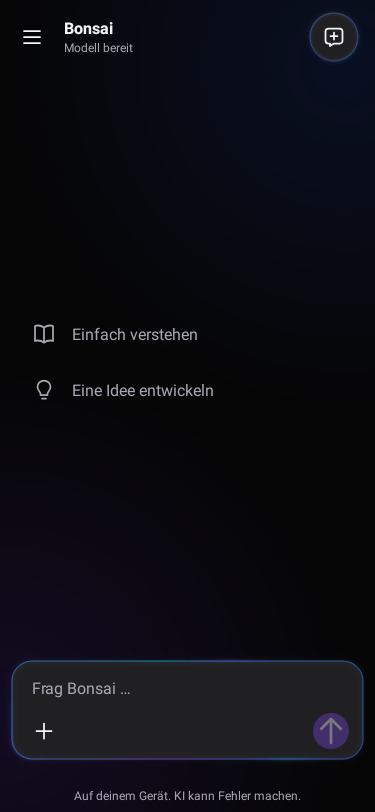
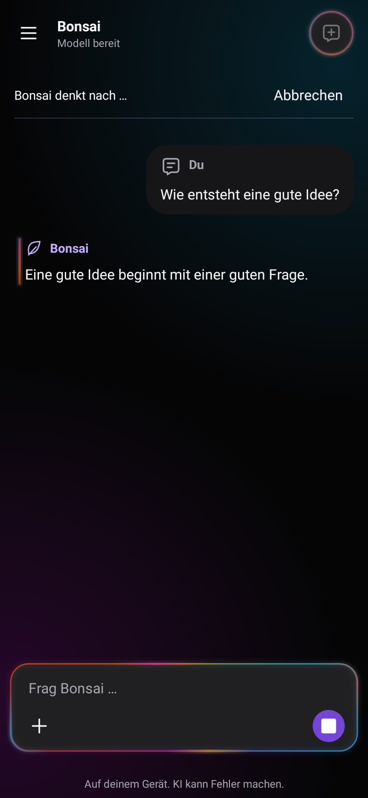

# Native Oberfläche: PocketPal-Layout und Liquid-Interaktionen

Bonsai bleibt eine vollständig offline arbeitende Android-App. Die Kernaufgabe:
ein lokales GGUF-Modell laden, eine Frage stellen und die gestreamte Antwort lesen.
Das Layout orientiert sich an [PocketPal AI](https://github.com/a-ghorbani/pocketpal-ai), insbesondere dessen Chat-Screenshot und der Anordnung im aktuellen `ChatInput/styles.ts`. Übernommen werden ausschließlich Anordnung und Abstände. Funktionen, Buttons, Inhalte, Bonsai-Icons und Farbrollen bleiben erhalten. Keine Pals-, Sprach-, Kamera- oder zusätzlichen Menüaktionen.
Ein Chat/Work-Umschalter ist ausdrücklich nicht vorgesehen.

## Aufbau

- Kompakte Kopfzeile: Menü links, Bonsai-Titel und Status links ausgerichtet untereinander, neuer Chat rechts.
- Viel freier Raum; bei geladenem Modell stehen zwei bearbeitbare Prompt-Einstiege
  im vertikal zentrierten Inhaltsbereich. Der Einstieg ohne Modell behält seine Texte und seine Import-/Ladeaktion.
- Die breite Chatbar hat einen Textbereich oben und eine Kontrollzeile mit dem vorhandenen Plus links und Senden/Stop rechts. Sie ist auch vor dem Modellimport sichtbar. Entwürfe lassen sich vorbereiten;
  Senden bleibt ohne geladenes Modell gesperrt. Das Plus öffnet Modell und Einstellungen.
- Die Seitenleiste enthält Modell, Leistung, Chats und Archiv. Ein neuer Chat ist
  oben im scrollbaren Menü erreichbar, auch bei großer Schrift. Löschen erscheint nur bei vorhandenem aktuellem Chat.
- Modell und Leistung öffnen weiterhin native Pop-ups. Chat, Entwurf, lokale Tools,
  SQLite-Verlauf, Antwortvarianten und laufende Inferenz behalten ihre Abläufe.
- Touch-Ziele bleiben mindestens 48 dp groß. Eingabe und Texte können wachsen;
  Inhaltsbreite auf Tablets höchstens 720 dp. Tastatur- und Systemleisten-Inset bleiben erhalten.
- Nutzerblasen passen sich der Textbreite an und stehen rechts; Antworten nutzen die offene Lesefläche links. Autoren, Metadaten, Kopieren und Regenerieren bleiben erhalten.

## Liquid-Bewegung

`LiquidComposer` ergänzt die vorhandene `PulsingBorder`-Chatbar. Beim Berühren gibt die Fläche leicht nach (99,2 % Breite, 96,5 % Höhe), beim Loslassen federt sie in 460 ms zurück. Beim Eingabefokus hebt sie sich um 2 dp. Neue Berührungen unterbrechen den laufenden Übergang. Touch-Ereignisse werden an die bisherigen Kinder weitergereicht; Textauswahl, Scrollen, Plus, Senden und Abbrechen behalten ihre Verarbeitung. Beim Abhängen wird die Transformation zurückgesetzt.

Vorhandene Icon- und Textaktionen erhalten ein kurzes Nachgeben und eine federnde Rückkehr; Seitenleiste und Pop-up-Inhalte öffnen ebenfalls weich. Keine Animation pro Streaming-Token, kein neuer Dauer-Timer. Systemweit ausgeschaltete Animationen und Energiesparen überspringen die Bewegung.

## Reasoning-Vorschau

Eine dezente Inline-Fläche sitzt direkt unter dem Autor der aktuellen Antwort. Während das Modell denkt, zeigt sie eine Zeile aus dem echten `onThinking`-Stream. Die gesamte Kopfzeile ist ein mindestens 48 dp hohes Touch-Ziel; ein Chevron kennzeichnet das Aufklappen. Ausgeklappt ist der Reasoning-Text separat scrollbar und auswählbar, mit höchstens 160 dp Höhe. Die Fläche nutzt die bestehenden neutralen Farbrollen und 14-sp-Typografie.

Sobald Antworttext eintrifft, klappt die Vorschau automatisch auf die Kopfzeile „Reasoning“ zusammen. Sie lässt sich weiterhin öffnen. Streaming ersetzt die Fläche nicht und startet keine Animation pro Token; nur das manuelle Aufklappen erhält den bestehenden weichen Übergang. Ohne Reasoning bleibt die Fläche verborgen. Vorverarbeitung und eigentliche Antwort bleiben getrennt.

Die Vorschau enthält höchstens die letzten 8.000 UTF-16-Zeichen, erhält Zeilenumbrüche und verarbeitet auch über mehrere Chunks verteiltes UTF-8 korrekt. Sie bleibt ausschließlich im Arbeitsspeicher für die aktuelle Antwort und wird bei neuer Generierung, Chatwechsel, Abbruch oder Fehler geleert. Sie wird weder als Chatantwort gespeichert noch an den Modellkontext angehängt. Späte Callbacks eines abgeschlossenen oder abgebrochenen Durchlaufs werden verworfen.

Prüfungen: Unicode-Chunkgrenzen und Puffergrenze in `InferenceProgressTest`; Ein-/Aufklappen, stabiles Streaming, Übergang zur Antwort und helle/dunkle Renderaufnahmen in `AppExperienceTest`; Abbruch und verspätete Callbacks in `BackgroundInferenceTest`.

Validierung der Erweiterung: 181 Tests, 0 Fehler, 2 übersprungen; ARM64-CPU-Debug-APK und Lint erfolgreich. Native Renderaufnahmen verwenden Testdaten. Das Bewegungsgefühl auf einem physischen A55 ist weiterhin ungeprüft.

Vorschauen: [Live-Auszug hell](ui/reasoning-light-compact.png), [aufgeklappt bei großer Schrift](ui/reasoning-dark-large-expanded.png), [eingeklappt über der Antwort](ui/reasoning-light-answer.png).

## Farben

Die App folgt dem System-Theme; `DesignTokens` und beide Android-Styles stimmen überein.

| Token | Dunkel | Hell |
|---|---|---|
| Hintergrund | `#050506` | `#FAFAFA` |
| Fläche | `#161618` | `#F0F0F3` |
| Eingabe | `#202023` | `#FFFFFF` |
| Text | `#F5F5F7` | `#1B1B20` |
| Sekundärtext | `#A6A6B0` | `#62626E` |
| Akzenttext / Fokus | `#C4ADFF` | `#6540B5` |
| Primäre Aktion | `#7545D6` | `#7545D6` |

Text-, Fokus- und Kontrollkontraste sind unabhängig vom dekorativen Lichtsaum.
Das Eingabefeld hat einen dauerhaften Accessibility-Namen. Statusmeldungen und
Abbrechen bleiben zusätzlich zum Farbwechsel sichtbar.

## PulsingBorder in Java

`PulsingBorder` ist eine native `FrameLayout`-Komponente mit Canvas, `SweepGradient`,
`RadialGradient` und einem vermessenen abgerundeten Pfad. Sie interpretiert den
bereitgestellten Paper-Shaders-Effekt in Java; sie ist kein identischer Port des
zugrunde liegenden WebGL-Shaders. Keine npm-Abhängigkeit, kein WebView, keine neue
Berechtigung und keine Änderung an der C++-/Vulkan-Modellruntime.

Die drei Presets übernehmen die gelieferten Werte für speed, intensity, bloom,
pulse, smoke, spots, spotSize und colors. Umlaufende Farbsäume, weiche Lichtlagen
und wandernde lokale Highlights erzeugen den Effekt. Farbwechsel werden über
650 ms überblendet, ohne Text oder Layout zu bewegen.

| Zustand | Darstellung | Auslöser |
|---|---|---|
| Idle | langsames Blau / Violett / Cyan | bereit oder Entwurf |
| Generating | bewegtes Cyan / Magenta / Koralle / Amber | laufende Arbeit |
| Done | kurzer grüner / cyanfarbener Saum | erfolgreicher Abschluss |

Done geht nach 1,8 Sekunden in Idle über. Fehler und Abbruch lösen keinen Erfolgssaum aus.
Die Beleuchtung ist in der gesamten App verteilt und teilt denselben Zustand:

- **Bildschirmränder:** Zwei weiche, langsam wandernde Farbfelder. Die Mitte der
  Lesefläche bleibt dunkel; im hellen Theme ist die Deckkraft zusätzlich reduziert.
- **Neueste Antwort:** Eine schmale Lichtlinie am linken Rand; ältere Antworten
  und der Text selbst bleiben ruhig. Das Streaming verwendet dieselbe TextView.
- **Modell und Leistung:** Sanfte Konturen um die Status-/Ergebniskarte und die
  jeweilige Hauptaktion, zusätzlich zu einem dezenten Lichtfeld im Pop-up.
- **Seitenleiste:** Eigenes Lichtfeld, zurückhaltend beleuchteter aktueller Chat
  und die Aktion für einen neuen Chat.
- **Chatbar:** Der stärkste Randakzent. Die übrigen Konturen verwenden nur
  25–60 % ihrer Stärke; Formulare und normale Menüeinträge haben keine Dauerkontur.

`PulsingBorder` bietet die Modi BORDER, AMBIENT und RAIL. Ein gemeinsamer
`Choreographer`-Callback synchronisiert die sichtbaren Effekte mit der
Bildausgabe. Die Beleuchtung bleibt auch während Inferenz und Benchmarks animiert.
Konturen haben im stabilen Arbeitszustand mindestens 42 ms Abstand zwischen
Updates (höchstens ca. 24 fps), im Leerlauf 50 ms (20 fps). Die langsamen
Hintergrundfelder benötigen nur alle 84 ms ein Update (höchstens ca. 12 fps).
Kontur-Übergänge und der kurze Done-Zustand verwenden 34 ms (ca. 29 fps).
Die tatsächliche Bildrate hängt von Display und Auslastung ab; der Bewegungsschritt
richtet sich nach der verstrichenen Zeit. Der gemeinsame Taktgeber berücksichtigt
für jede Fläche ihre nächste Fälligkeit. Die Activity verwaltet getrennte
Gruppen für Hauptansicht, Chatinhalt, Pop-up und Seitenleiste. Ersetzte Inhalte
werden aus dem Taktgeber und der Zustandsverteilung entfernt. Je Hauptansicht
animieren höchstens vier Lichtflächen gleichzeitig.

Die Glühkontur verwendet drei statt fünf Bloom-Schichten und zwei statt drei
Schichten je lokalem Highlight. Die Summe der Alpha-Gewichte bleibt erhalten;
Farbpaletten, Spotanzahl, Bewegung und 650-ms-Farbwechsel
bleiben erhalten. Jeder Highlight-Durchlauf wird auf das Quadrat seines
Radialverlaufs begrenzt, außerhalb dessen der Shader ohnehin transparent ist.
Der Umfang wird beim Größenwechsel berechnet. Pfade, Shader und Matrizen werden
wiederverwendet; der Frame-Loop allokiert keine Zeichnungsobjekte. Animationen
pausieren bei verlorener Fenstersichtbarkeit/-fokussierung, abgehängten Views,
gestoppter Activity, deaktivierten Systemanimationen und Energiesparmodus.
Der Energiezustand wird höchstens einmal pro Sekunde abgefragt. Hinter Sidebar
und Pop-ups pausieren die Effekte des verdeckten Chats.

Text-, Thinking- und Prefill-Updates aktualisieren nur die laufende Antwort und
Fortschrittsanzeigen. Kopfzeile, Modell-/Leistungskarten und Sendeaktionen werden
bei Zustandsänderungen aktualisiert. Unveränderter Antworttext behält seinen
Textpuffer und seine Auswahl; Textmodus und Metadaten werden nur bei Änderungen
neu gesetzt. Der Sekunden-Timer aktualisiert nur den Status. Scroll-Aufträge
werden zusammengefasst und beim Stoppen der Activity entfernt.

## Prüfung und Vorschauen

`AppExperienceTest` prüft weiterhin Chat, Seitenleiste, Pop-ups, Draft-Erhalt,
Streaming, Kopieren, Antwortvarianten, Fehler, Theme-Kontraste, 200 % Schrift,
schmale Displays und Tablet-Breite. Zusätzliche Prüfungen decken die drei
Effektzustände, Rückkehr zu Idle, Fehler/Abbruch, verdeckte Ansichten,
Activity-Lebenszyklus, reduzierte Bewegung und Energiesparen ab. Die Erweiterung
prüft außerdem gemeinsame Effektzustände über Chat und Pop-ups, das Pausieren
verdeckter Flächen, das Freigeben ersetzter Karten und die Navigation des
beleuchteten aktuellen Chats.

Native Robolectric-Renderaufnahmen; die dargestellten Inhalte und der Modellstatus
sind Testvorgaben und kein Nachweis einer Geräte-Inferenz:

| Chat bereit | Generierung |
|---|---|
|  |  |

Weitere Ansichten: [Seitenleiste](ui/sidebar-dark.png), [Modell](ui/model-light.png),
[Leistung](ui/performance-light.png), [Einstieg hell](ui/welcome-light.png),
[große Schrift](ui/large-text-dark.png), [Abschluss](ui/glow-done-dark.png),
[Modell mit dynamischem Licht](ui/app-light-model-dark.png),
[laufende Leistungsmessung](ui/app-light-performance-dark.png) und
[aktueller Chat in der Seitenleiste](ui/app-light-sidebar-dark.png).

Validierung des aktuellen Layouts und der Interaktionen siehe [PocketPal-Layoutprüfung](validation/POCKETPAL-LAYOUT.md). `LiquidComposerTest` prüft die Weiterleitung von Klicks, Touch-Abbruch und unmittelbar neutrale Transformationen bei ausgeschalteten Systemanimationen.
Ein physischer A55-Test für Bildrate, Tastatur, TalkBack und parallele echte
Modellinferenz bleibt erforderlich. Es ist kein Gerät angeschlossen.
