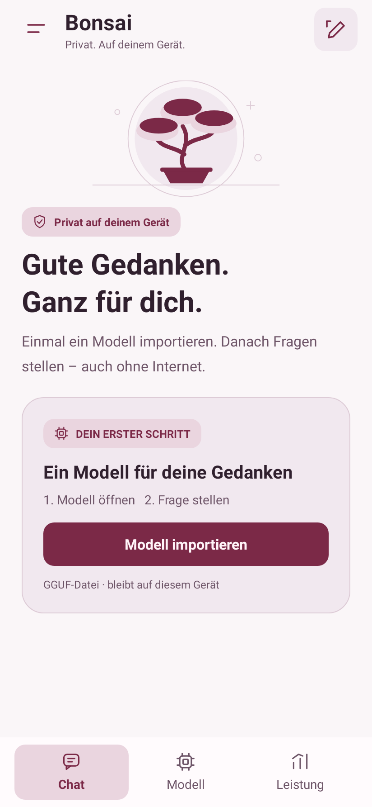

# UI-Überarbeitung: Burgunder & Pflaume

Ziel: Deutschsprachige Nutzer auf dem Galaxy A55 öffnen ein lokales Modell, stellen eine Frage und lesen die Antwort. Die Umsetzung folgt den [bereitgestellten Richtlinien](UI-UX-GUIDELINES.md) und dem ergänzten Farbwunsch Burgunderrot/Pflaume.

## Design-System

Die native Android-Oberfläche verwendet `DesignTokens.java`. System-Theme und Systemschrift werden respektiert; der Plattformdialog erhält das passende Theme aus `values/styles.xml` beziehungsweise `values-night/styles.xml`.

| Token | Hell | Dunkel |
|---|---|---|
| Hintergrund | `#FAF6F8` | `#1C151E` |
| Fläche | `#F1E8EF` | `#2D2231` |
| Text | `#30202E` | `#F6EDF4` |
| Sekundärtext | `#6D5467` | `#CBB7C8` |
| Akzenttext / Fokus | `#7B2947` | `#E6A7C1` |
| Primäre Aktion | `#7B2947` | `#8F3153` |
| Text auf primärer Aktion | `#FFF4F8` | `#FFF4F8` |

Abstände basieren auf 8 dp mit 4-dp-Zwischenschritten, Schriftgrößen auf 12/14/16/24/32 sp. Fließtext verwendet 16 sp und 1,4-fache Zeilenhöhe. Interaktive Ziele sind mindestens 48 dp hoch, Icon-Buttons 48 × 48 dp. Die Inhaltsbreite ist auf Tablets auf 720 dp begrenzt.

## Hauptabläufe

- **Chat:** Beim ersten Start steht der Modellimport im Vordergrund. Nach dem Laden erscheinen zwei Eingabehilfen und die beschriftete Nachrichteneingabe. Während einer Antwort bleibt das nächste Eingabefeld bearbeitbar; Abbrechen ist jederzeit erreichbar. Bei einem fehlgeschlagenen oder abgebrochenen Sendevorgang wird der gesendete Text wieder eingesetzt, sofern noch kein neuer Entwurf vorhanden ist.
- **Modell:** Import, Laden und Einstellungen befinden sich auf einem eigenen Screen. Die primäre Aktion bleibt am unteren Rand erreichbar; die Inhalte darüber scrollen. Labels sind mit den nativen Auswahlfeldern verknüpft.
- **Leistung:** Der Screen erklärt die Messung, zeigt vorhandene echte Ergebnisse und bietet Optimierung, Benchmark und Export an. Ohne geladenes Modell führt die Hauptaktion direkt zum Modell-Screen.
- **Verlauf:** Die Liste öffnet sich von links. Ein leerer Verlauf erklärt seine Funktion. Löschen erfordert eine konkret beschriftete Bestätigung.
- **Antwortvarianten:** „Neu generieren“ legt einen eigenen Chat mit dem bisherigen Kontext vor der letzten Frage an. Der Originalchat und seine Antwort bleiben unverändert.

Fehler werden in der Oberfläche mit einem nächsten Schritt sichtbar. Technische Details und Diagnosen bleiben über gezielte Dialoge erreichbar. Es gibt keine erfundenen Messwerte.

## Bewegung

`UiMotion.java` bündelt drei Muster:

1. Gerichtete Navigation und neue Chatansichten: 250 ms, Translation/Deckkraft.
2. Verlauf öffnen/schließen: 250/180 ms, Translation/Deckkraft.
3. Druckfeedback auf Icon-Buttons: 150 ms, Skalierung; Textaktionen verwenden natives Ripple-Feedback.

Bei abgeschalteten Android-Animationen werden Transformationen sofort auf den Endzustand gesetzt. Die dekorative Orbit-Dauerschleife wurde entfernt. Streamender Text wird in derselben TextView aktualisiert, ohne bei jedem Token zu springen oder erneut einzublenden.

Statusmeldungen und Abbrechen erscheinen sofort. Der allgemeine Fortschrittsindikator erscheint nach 180 ms, bei längeren Vorgängen zusätzlich die verstrichene Zeit. Die Optimierung zeigt ihren bekannten Fortschritt. Importmengen werden aus dem bestehenden Importprozess übernommen. Unbekannte Restzeiten werden nicht geschätzt.

## Prüfung

`AppExperienceTest` prüft Tabwechsel, Rücknavigation, erhaltene Entwürfe, Wiederherstellung der Activity, Texteingabe, Fehlerzustand, Streaming ohne Austausch der TextView, Antwortvarianten ohne Datenverlust, Theme-Kontraste und deaktivierte Systemanimationen. Renderaufnahmen entstehen unter `app/build/ui-captures/`.

Getestete Layoutgrößen: 375 × 812 dp (Dunkel, einschließlich 200 % Schrift), 412 × 892 dp (Hell) und 1024 × 900 dp (Tablet). Die kleine Ansicht prüft auch einzeilige Tabnamen und erreichbare Touch-Ziele.

Berechnete Mindestkontraste über Hintergrund und Fläche: Text 5,63:1 (Hell) und 7,70:1 (Dunkel); Rahmen 3,51:1 und 4,40:1; Text auf Hauptaktionen 8,69:1 und 7,15:1.

Die Renderaufnahmen und UI-Tests verwenden Robolectric, keine echte Modellinferenz. Ein physischer A55-Test mit Systemtastatur, TalkBack, Displayaussparung und echter CPU-/Vulkan-Generierung bleibt separat erforderlich. Es wurden keine neuen Inferenz-Backends oder Netzwerkfunktionen ergänzt.

## Verifizierter Stand

`./gradlew :app:testDebugUnitTest :app:assembleDebug :app:lintDebug` erfolgreich: **11 Tests, 0 Fehler**, installierbare ARM64-CPU-Debug-APK und Lint ohne Fehler. Sechs Lint-Warnungen betreffen die SDK-abhängige Manifest-Eigenschaft, die bewusst fehlende ChromeOS-ABI sowie noch nicht in Übersetzungsressourcen ausgelagerte deutsche Texte. Die Hostprüfung von Manifest/XML, JNI-Bindung und UTF-8-Streaming ist ebenfalls erfolgreich.

Die lokale Prüfung verwendet JDK 17, Android SDK 35, NDK 28.2.13676358 und CMake 3.22.1. Die APK wurde als CPU-Build erstellt; Vulkan-Laufzeitverhalten wurde nicht getestet.

### Native Vorschauen

Die Screenshots zeigen deterministische UI-Testzustände; insbesondere „Modell bereit“ ist eine Testvorgabe und kein Nachweis für Modellinferenz auf diesem Rechner.

| Einstieg · Hell | Chat bereit · Dunkel |
|---|---|
|  |  |

Weitere Ansichten: [Modell](ui/model-light.png), [Leistung](ui/performance-light.png), [375 dp und 200 % Schrift](ui/large-text-dark.png).

## Detailreichere native Oberfläche

Die Burgunder-/Pflaume-Farbwelt erhält drei zusätzliche Flächentokens (`raised`,
`accentSurface`, `subtleBorder`) für Eingabe, Badges und feine Kartenkonturen.
`UiArtwork.java` zeichnet ein Bonsai-Motiv und ein einheitliches Icon-Set direkt
mit Android Canvas. Es gibt keine Bilddownloads oder zusätzlichen Bibliotheken.
Das dekorative Motiv ist aus dem Accessibility-Baum ausgeschlossen.

- Der Einstieg zeigt das Bonsai-Motiv, einen Datenschutzhinweis und eine
  gegliederte Importkarte. Bei geladenem Modell ist das Motiv kompakter.
- Die zwei Prompt-Vorlagen haben Icons, Kurzbeschreibungen und Richtungspfeile;
  Antippen setzt weiterhin einen bearbeitbaren Entwurf ein.
- Die Hauptnavigation kombiniert Icons mit den vorhandenen Textlabels. Die aktive
  Seite hat eine eigene Akzentfläche; Fokus- und Druckfeedback bleiben erhalten.
- Modellstatus, aktuelle Thread-/Kontextwerte und Antwort-Einstellungen sind
  visuell gruppiert. Die Leistungsansicht erklärt den Ablauf in drei nummerierten
  Schritten und zeigt weiterhin ausschließlich vorhandene Messwerte.
- Autoren und Antwortaktionen im Chat sowie der Verlauf erhalten passende Icons.

Die Eingabe und Hauptaktionen bleiben außerhalb der scrollenden Inhalte.
Große Systemschrift darf Karten vergrößern; Text wird nicht auf feste Höhen
beschnitten. Die neuen Farbflächen sind in die Kontrastprüfung aufgenommen.
Ein zusätzlicher UI-Test prüft beide Prompt-Vorlagen, den Sendestatus und die
sichtbare Eingabe auf einem 375-dp-Display.

Prüfung dieser Ergänzung: **50 Robolectric-/JUnit-Tests, 0 Fehler, 0 übersprungen**.
Die aktualisierten Bilder unter `docs/ui/` wurden aus diesen Tests übernommen
und visuell kontrolliert. Sie zeigen Testzustände und keine echte Modellinferenz.
