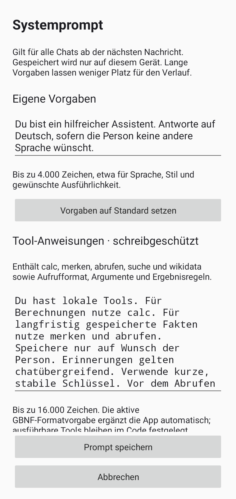
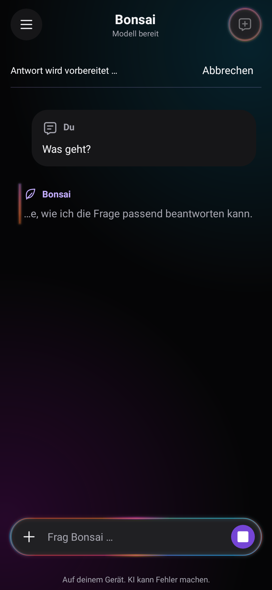
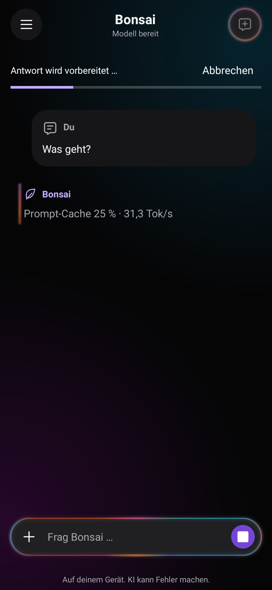

# Anpassbarer Systemprompt und einzeilige Live-Anzeige

Stand: 22. Oktober 2026. Featurebranch `feat/editable-system-prompt`, Basis
`b6431a00d8d411e1db7e02f09aa33f6b566cc261`. Diese Änderung gehört zum
Nachfolgestand und ist nicht Teil der bereits veröffentlichten v0.5-APK.

## Verhalten

- **Menü → Modell → Antworten anpassen → Systemprompt bearbeiten** trennt eigene
  Vorgaben von Tool-Anweisungen. Der Tool-Bereich ist zunächst lesbar, aber
  schreibgeschützt; Bearbeiten und Reset benötigen eine bestätigte Warnung.
  Beim nächsten Öffnen und nach Activity-Neuerstellung wird erneut gesperrt.
- Änderungen bleiben bis zum Speichern Entwürfe. Abbrechen verändert nichts;
  eine Activity-Neuerstellung erhält den Entwurf. Gespeichert wird lokal für
  alle Chats. Während einer laufenden Berechnung wird Speichern abgewiesen.
- Der alte Standardprompt bleibt bytegleich (SHA256 ohne GBNF:
  `973781cee87b1adf2e4ba50a75659aa244bd054249b8baee354224616ead61d2`).
  Nicht angepasste Bereiche folgen künftigen App-Standards. GBNF wird weiterhin
  automatisch ergänzt; Java-Tools und Argumentprüfung bleiben fest definiert.
- Speichern verwirft den bisherigen Cache. Vorwärmen, alle Tool-Runden und
  finales Cache-Commit verwenden denselben Prompt. Der Chat-Benchmark speichert
  nur Prompt-Hash und Anpassungsstatus; der Vergleich prüft die Hashgleichheit.
- Die vom Nutzer im Screenshot markierte Zeile unter „Bonsai“ zeigt entweder
  aktuellen Thinking-Text oder `Prompt-Cache … % · … Tok/s`. Thinking bekommt
  einen separaten UTF-8-Kanal, bleibt auf die letzten 240 Zeichen begrenzt und
  wird weder als Antwort noch in SQLite/Logs/Benchmarkantworten gespeichert.
  Lange Zeilen zeigen das Ende; die Endantwort darf wieder normal umbrechen.
- Prefill-Fortschritt umfasst wiederverwendete plus frisch dekodierte Tokens.
  Die Rate zählt nur neue Tokens pro gemessener Decode-Zeit. Updates erfolgen
  nach abgeschlossenen Decode-Batches; Batchgröße und KV-Größe bleiben gleich.
  Vor der ersten Messung wird keine Zahl erfunden. Ein Modell ohne Thinking
  erhält keine künstlichen Gedanken. Abbruch/Abschluss verwerfen den Live-Status.

## Ausgeführt

| Prüfung | Ergebnis |
| --- | --- |
| `:app:testReleaseUnitTest` (CPU-Konfiguration) | **151 Tests**, 0 Fehler, 0 fehlgeschlagen, 0 übersprungen |
| `:app:lintRelease` | 0 Fehler; 9 Warnungen, darunter bestehende Plattform-/ABI-/Textwarnungen und eine weitere Textressourcenwarnung im Editor |
| Native ARM64-Bibliothek, CPU/Vulkan-Konfiguration | erfolgreich kompiliert und gelinkt; bestehende Warnungen aus Runtime-Headern |
| `-PbonsaiVulkan=true :app:assembleRelease` | unsignierte CPU/Vulkan-APK erfolgreich gebaut |
| `tests/test_benchmark_compare.py` | 4 Tests bestanden; verschiedene/einseitig fehlende Prompt-Hashes zurückgewiesen |
| `scripts/check_project.py` | Manifest/XML/JNI/Runtime sowie UTF-8- und C++-Reasoning-Schnittstellentests bestanden |
| Standardprompt-Vergleich gegen Basiscommit | bytegleich; kein stiller Default-Wechsel |

Robolectric prüft Warnung/Abbruch/Speichern/Reset, Menüzugang, Activity-Neuerstellung,
Cache-Reset, identischen Prompt bei Vorwärmen/Tool-Runden/Commit sowie getrennte
Thinking-/Antwortkanäle und einzeilige Darstellung mit anschließendem Umbruch.
Die Fachtests erzeugen Modellantworten und Geschwindigkeiten künstlich.

## Renderbelege mit Testdaten

Diese Bilder stammen vom Host-Renderer, nicht vom Galaxy A55. Thinking-Text und
**31,3 Tok/s** sind ausschließlich Testinhalte, keine gemessenen Gerätewerte.

| Prompt-Editor | Thinking-Zeile | Prefill-Zeile |
| --- | --- | --- |
|  |  |  |

## Ausstehend

Installation des neuen Builds und reale Modellantworten auf dem A55, tatsächliche
Prefill-Rate, Lesbarkeit bei großer Schrift/Tastatur, Abbruch und App-Wechsel
sowie persönliche Bewertung des Editors und der Wartezeile. Der Nutzer-Screenshot
belegt die vorherige statische Anzeige, aber keine Version, Laufzeit oder
erfolgreiche Antwort. Konkrete nächste Schritte: P01–P06 im
[A55-Testplan](../../A55-ECHTWELT-TESTPLAN.md).
